# Changelog

All notable changes to Lucid are recorded here, newest first.

## v1.21 — 2026-11-13

**Lucid is an ecosystem.** It began as a shell around your windows; now it is
everything between logging in and logging out, made to belong together. It has
apps of its own: Lumen for your files and every app's file dialog, Lens for
pictures and videos, and a rebuilt LucidShot. Its own icons and its own
pointer are drawn in your palette, and the login screen matches the lock. The
desktop is arranged in edit mode right where it stands, the bar can take the
bottom edge and open its panels as one shape with it, the control centre is laid
out on a grid of your own, whatever plays comes with its lyrics, and everything
moves on springs.

Twenty-three of the pull requests in this one are **Ciro Rivera**'s, the
entries marked with a number below unless someone else is named. Thank you,
Ciro, and thank you @SKetU-l and @naevui.

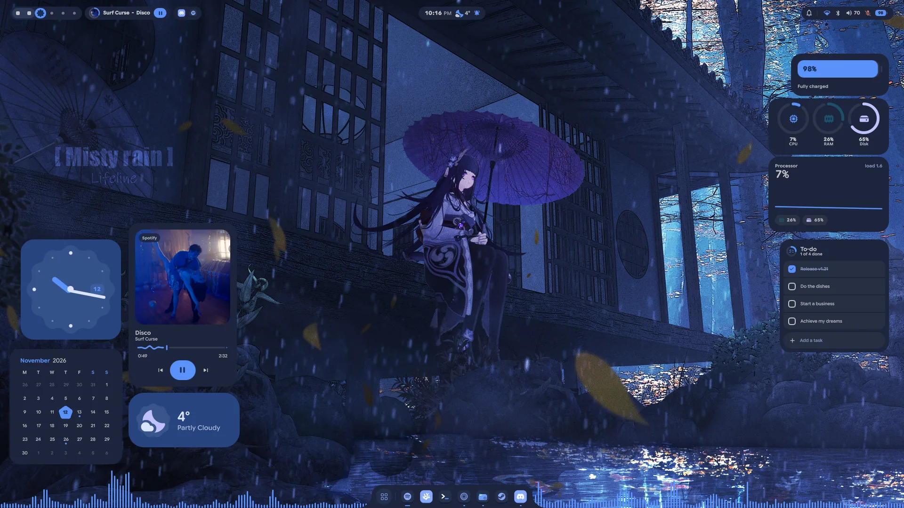

### Apps of Lucid's own

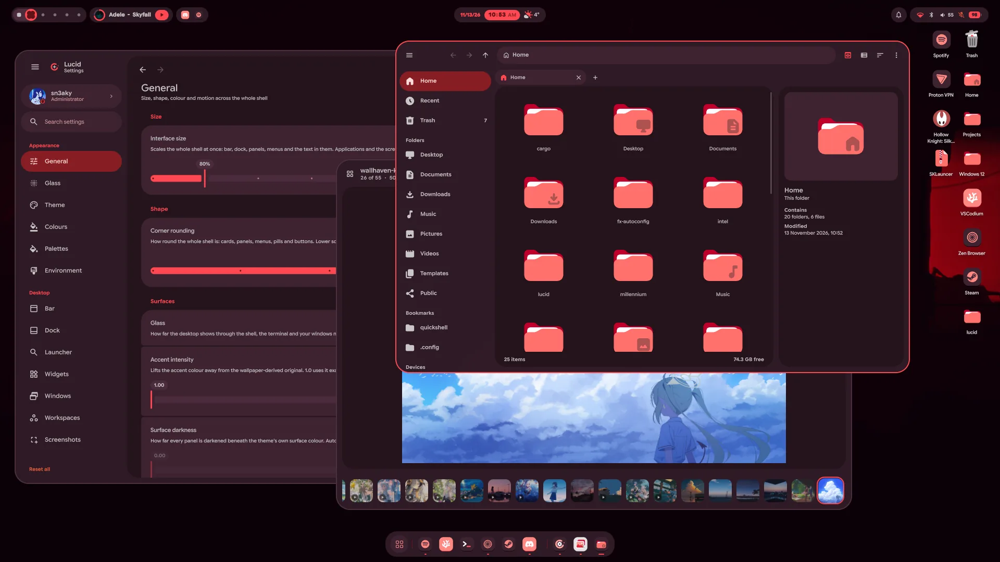

- **Lumen, a file manager of Lucid's own, and every app's file dialog.**
  SUPER+E opens it, folders open in it, and the *Open* and *Save* dialogs of
  every app are Lumen windows too, filters, overwrite check and all. Tabs with
  a strip that always shows: pin one and it stays at the front of every new
  window, give it a colour, drag it out into a window of its own and back.
  Bookmarks with names and colours (Ctrl+D), Recent, Trash, your drives under
  *Devices* with eject, a path bar you can type into, a grid or a list that
  zooms from 24 to 256 pixels, and a preview pane. Right-click for *Open
  with…*, *Set as wallpaper*, copying the path, compressing and extracting, and
  more. Copies and moves run in the background, and Lumen does not quit until
  they are done.
- **Network drives in Lumen.** *Connect to server* (Ctrl+K, the sidebar's new
  *Network* section or the ⋮ menu) opens a shared folder on another computer, a
  NAS or a server. Type its address (`smb://nas.local/media`,
  `sftp://you@server`, `ftp://…`, Windows' own `\\server\share`, or just a
  name) and sign in if it asks: as a registered user or a guest, with the
  password kept in your keyring if you tick it. A host Lumen has never seen asks
  first. Connected shares sit under *Network* with their free space and a
  button that disconnects them, and their files open, copy, move, rename and
  delete like any others; a share has no trash, so deleting says it can't be
  undone. Apps' open and save dialogs reach them too. Bookmark a folder on a
  share and a click on it connects again later; the addresses you typed stay
  in the dialog's *Recent* list, and *Nearby* shows the computers sharing
  folders on your network once Avahi runs.
- **Lens, a picture viewer of Lucid's own.** Open a picture and the rest of
  its folder comes with it, in the order Lumen shows that folder: the arrow
  keys, a swipe or a drag slide to the next one, the filmstrip jumps to any,
  and *All pictures* (G) lays out the whole folder to search by name. The
  wheel or a pinch zooms where the pointer is, a double click goes to 100%, and
  a zoomed picture pans with a map of where you are. *Edit* (E) crops it (free,
  its own shape, square, 4:3, 3:2, 16:9 or your screen's), turns, flips and
  straightens it, adjusts its light and colour, or gives it one of twelve
  looks; *Draw* (D) adds pen, highlighter, arrows, lines, boxes, rings, words
  and boxes that pixelate what is under them. Edits wait for each picture until
  they are saved, over it or as a copy; a turned JPEG is saved without losing
  any quality. Saving over a picture keeps its original, for good: *Revert to
  original* (right-click, the editor or *Details*) brings it back whenever you
  like, and holding \ shows it in the edited one's place. Right-click for *Set
  as wallpaper*, *Open with…*, *Show in Lumen*, copying the picture, its path,
  the text in it or a colour off it, sending it to your phone, renaming it and
  the trash. *Details* (I) show the camera's settings, where it was taken, a
  histogram and the colours it is made of. Slideshow (F5) and full screen (F)
  too.
- **Videos in Lens.** Videos sit in the folder with the pictures and play
  where they are, with a time line that waves while they play, volume, speed
  and play-on-repeat; a click pauses, a double click goes full screen, and J,
  L, comma and full stop step back and on. A frame can be saved as a picture or
  copied, a sideways phone video turned upright without encoding it again (its
  original kept), and *Trim* (E) cuts a part out as a copy: exactly at the
  handles, or at once at the nearest keyframe. `lens --default-videos` makes
  Lens what opens videos as well.

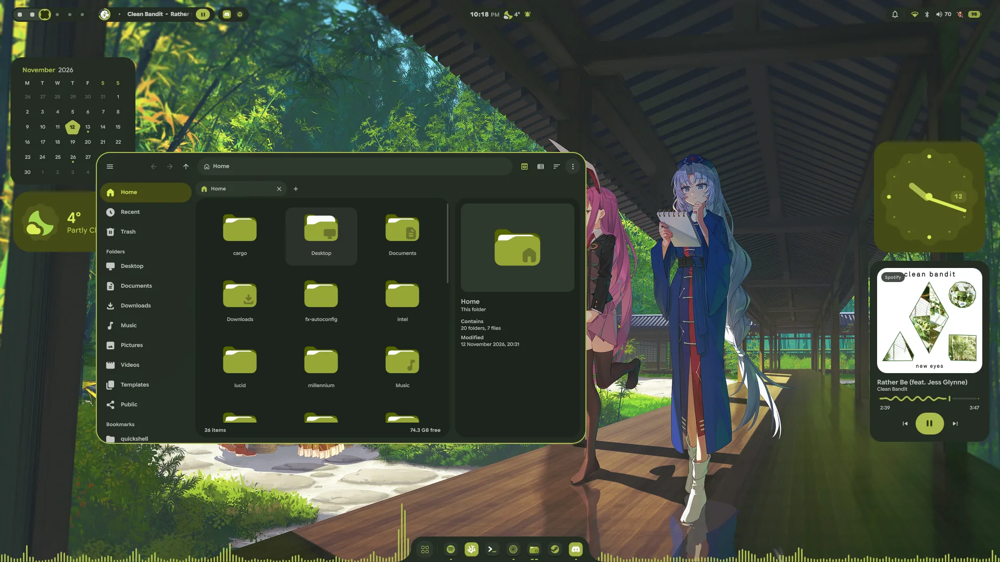

### Edit mode

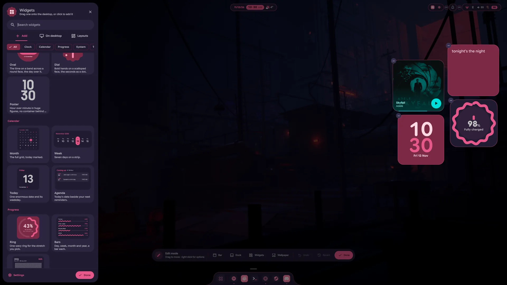

- **Arrange the desktop where it stands.** Pick *Edit Desktop* from the
  desktop's right-click menu, or right-click any bar module, and the wallpaper
  shades over so everything on the desktop can be arranged in place. Drag a bar
  module along the bar to move it, into another group, or down off the bar to
  take it out; one that has nothing to show right now keeps a dashed stand-in,
  so it can be moved too, and the link between two neighbours joins them into
  one island. Right-click a module, or the dock, for a sheet of its options
  beside it: its looks, the bar's or the dock's style and sizes. A click still
  opens a module, so the look just picked can be seen. The dock gets a handle:
  drag it up to float the dock higher, or down into the bottom edge to make it
  a notch. **Undo** takes back the last change and **Revert** everything since
  edit mode began; **Done**, or Escape, leaves it.
- **The bar and the widgets are set up there now.** *Settings → Bar* loses its
  arrangement editor and the per-module cards, and *Settings → Widgets* its
  layouts and its catalogue: modules are moved and set up in edit mode, and
  widgets come from the widget panel on the desktop, which has the layouts too.
  The Bar, Dock and Widgets pages each have a button that opens edit mode.

### The bar

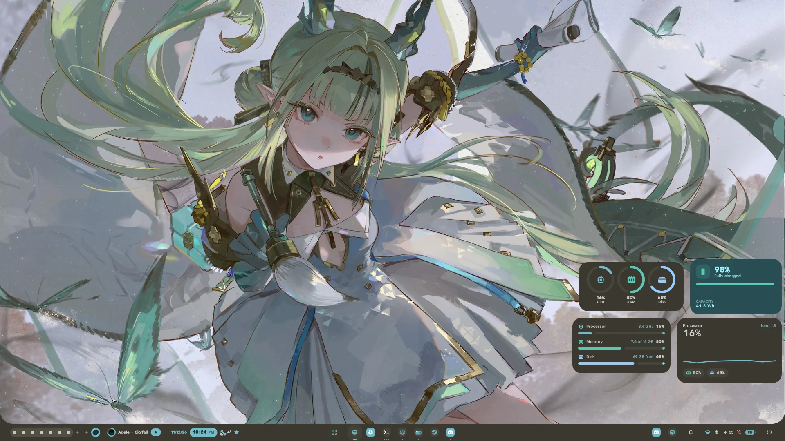

- **The bottom edge.** *Position* puts the bar on the bottom of the screen,
  and it slides over to the new edge. Its pop-ups open upwards, one that hides
  comes out of the bottom edge, and over a fullscreen window the launcher still
  rises from the edge. With the bar there the dock steps aside, and on a full
  bar the launcher rises out of the bar itself, one piece of glass with the
  strip. #100
- **Panels open as one shape with the bar.** On a full bar and with notches, an
  open panel grows out of the bar with no seam, panels side by side merge into
  one shape, and a module at either end can meet the screen's side and curve
  into it. #92, #95
- **Start and Apps.** *Start* is a button for the launcher, in a circle of its
  own, drawn as the dock's launcher button by default, or as Lucid's mark, your
  distro's logo, your picture or the word Start (#88). *Apps* puts the dock's pinned and running apps
  on the bar, with their dots, names and right-click menus; drag a pin to
  reorder it (#99). Joined, the two hover as one row.
- **The system tray, redesigned.** Both looks are rebuilt in Material You.
  *Icons* gives each app a slot like *Apps* does, with a mark that breathes
  when one wants your attention; *Collapsed* stacks the first three icons with
  a count. A click opens the tray: each app is a row with its real name, and
  its menu opens right in the row, submenus sliding in beside it. A right
  click on an icon opens that app's menu, a middle click and the wheel go to
  the app as before, and any app can be hidden from the bar.
- **The System module shows what you pick** of Wi-Fi, Bluetooth, the volume
  and its level, the microphone and the battery. #97
- **Content size.** *Settings → Bar → Content size* scales what is in the bar,
  80 to 140%, without changing the bar's own height.
- **Joins hold.** A link between two modules carries across one that has
  emptied out between them, and modules sit on whole pixels, so joined ones
  leave no seam. #96
- **Notch edges.** A notch's edge blends are frosted like the rest of the bar,
  light up with it on hover, curve as a quarter ellipse beside a short module
  instead of stepping, and can reach up to 64 pixels.
- **Calmer motion.** A panel closes on the exit curve, modules leave the bar in
  order instead of all at once, a module's contents hold still while hover
  grows its pill, switching a look animates, and a panel too wide for its place
  clears the bar around it. Over a fullscreen window an open panel stands above
  it.
- **Fewer, clearer looks.** The clock's day and date are bold, the date in the
  accent, and the window title is bolder. The Notifications module's *Accent*
  look and the window title's *Chip* look are gone; a bar that used them takes
  the default.

### Music

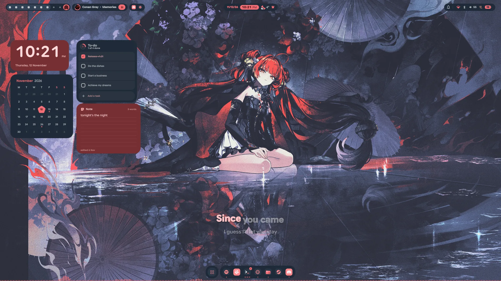

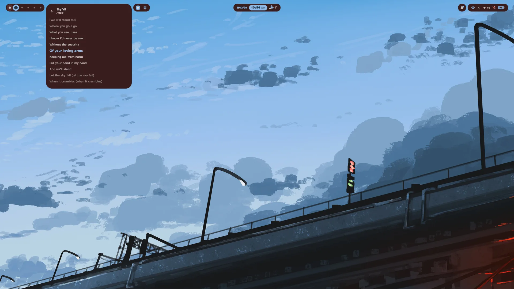

- **Lyrics.** The media panel has a *Lyrics* button beside *Identify*: the song
  scrolls by, the line being sung springs up to full size and fills with colour
  letter by letter, the word being sung stands up a little, and a pause is three
  dots that fill through it and let go just before the next line. A click on a
  line jumps there. `qs ipc call media lyrics` opens it too, and a switch on the
  media module's card in edit mode takes the button away. The new *Lyrics*
  widget follows the song in three looks: *Word by word*, captions that tip in
  and land as they are sung; *Karaoke*, the line filling letter by letter, the
  next one zooming up into its place as the last flies off; and *Classic*, the
  whole song scrolling by with the sung line lit. The words come from
  lrclib.net, looked up only while something shows them and kept on disk, so
  each song is fetched once. #109
- **The media module and its panel, rebuilt.** In the bar, *Progress* fills the
  pill as the song goes and *Controls* puts previous, play and next before the
  track; the panel comes as *Vinyl*, a record that turns while it plays,
  *Backdrop*, over the cover blurred across the panel, and *Mini*, besides side
  by side and the large cover (#89). The wave rests while a song is paused, and
  a track with no cover shows a crisp note.
- **Covers that never stall the shell.** Covers and GIFs from the internet are
  fetched into a cache of their own instead of through Qt's network stack,
  which could take the whole shell down. By @naevui in #86.

### Control centre

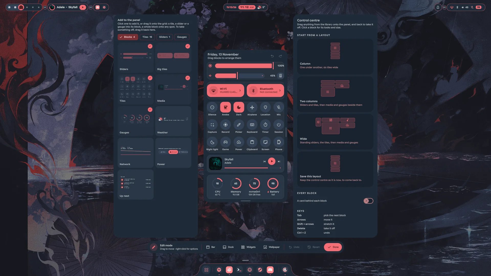

- **Lay it out your way.** The control centre can become a bento grid of
  blocks in an editor of its own, lifted off the bar to the middle of the
  display: sliders lying or standing (also *Wavy*), big tiles and small ones,
  what is playing, gauges, and four new blocks, the weather, the network,
  power profiles and what is up next. Each has looks of its own. Add them from
  a shelf with a search, drag them, undo, start from a ready layout, and make
  tiles of your own. Untouched, it stays the column it was, and a charging
  battery's gauge reads plainly. #90
- **Open it over IPC:** `qs ipc call controlcentre toggle` (or `open`,
  `close`), for a keybind of your own. #108

### The desktop

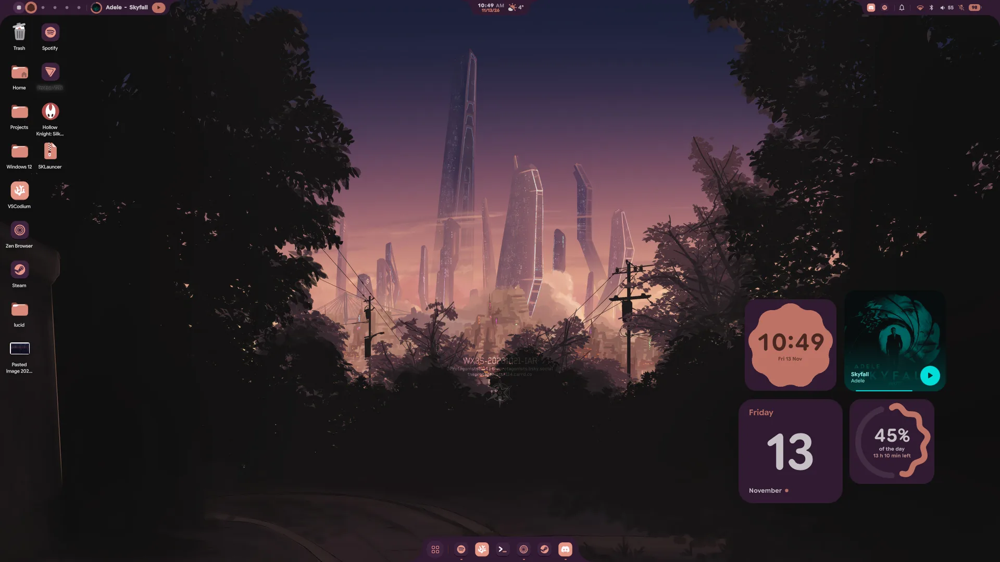

- **A Poster clock.** The hour over the minute in huge figures, straight on the
  wallpaper with no card behind them, in white or a colour from your palette.
- **The Lyrics widget**, in *Music* above. #109
- **Widgets stay over fullscreen windows by default** on a new install; *Hide
  for fullscreen windows* is still in *Settings → Widgets*, and a choice
  already saved stays as it is. #111

### LucidShot

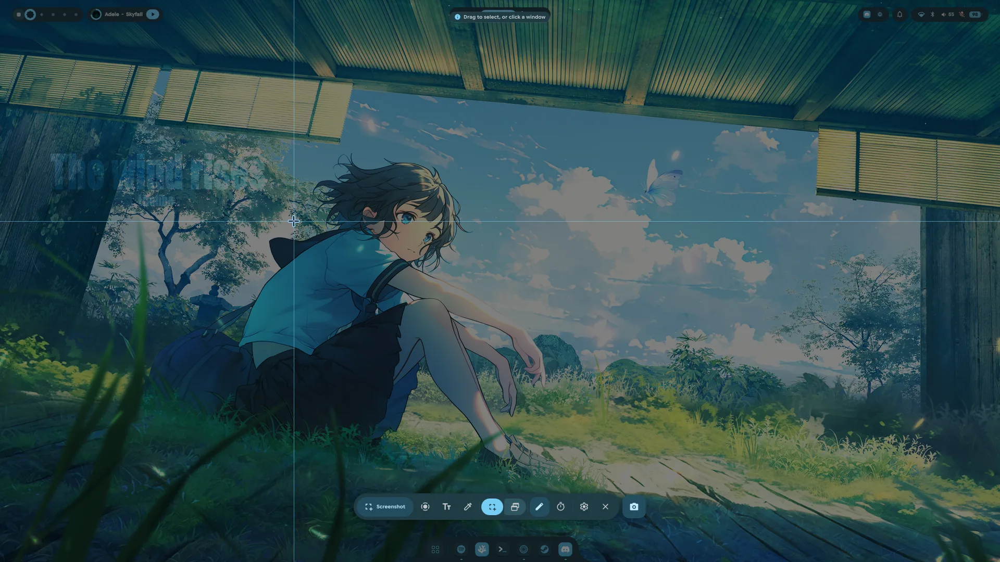

- **LucidShot, rebuilt.** Print freezes the screen under a Material You
  toolbar with a shutter beside it: *Screenshot*, *Record*, *Text* or
  *Colour*, of a region, a window or the whole screen. Drag out a region or
  click a window; a magnifier shows the pixels under the pointer, edges snap to
  the windows', Shift keeps it square, Alt grows it from the middle and Space
  moves it. The capture flies into a card in the corner to open in Lens, mark
  up, pin to the screen, read the text off, drag into an app, find in its
  folder or delete. With *Mark up before saving* (E) the selection stays put
  instead: pen, highlighter, arrows, boxes, ellipses, text, numbered steps and
  pixelation, with undo, then save, copy without saving or pin. Text read off
  the screen pastes the way it was written: lines that only wrapped on screen
  join up again, while lists, short lines and code keep their breaks. The
  self-timer takes it 3, 5 or 10 seconds later, live.
- **Colour and recording.** *Colour* turns the pointer into a lens over the
  frozen screen: a click copies HEX, RGB or HSL, Shift-click collects a
  palette. *Record* takes a region, a window or the screen with what is playing
  and, if you like, the microphone, mixed without muting anything; a countdown
  first, a pill with pause, the two sources and stop that tucks into the bar,
  and a recording carries on through a shell reload. A recording's card makes a
  GIF of it.
- **Settings and pins.** *Settings → Screenshots* has the folders, the card,
  window corners, the magnifier, the languages text is read in and the
  recorder's countdown, frame rate and encoder. Pinned captures float over your
  windows: drag them, scroll to size them, Ctrl and scroll to see through them,
  double-click to let go.

### Look and feel

- **Jelly motion.** Panels, pills, menus, the dock and its icons, the OSD and
  widgets settle on a spring, with a little wobble as they open and land.
  *Settings → General → Motion* turns it off or sets how much.
- **A pointer of Lucid's own.** The arrow, the hand and every other shape take
  the colours of your palette, *Dark*, *Light* or *Accent*, and fade along when
  the palette changes. The shapes are Bibata Modern's: Lucid fetches its source
  once and draws them on your machine, so nothing of Bibata ships with Lucid.
  *Settings → Environment*
  has it, the cursor tilt (only the arrows and hands lean as they move), and a
  switch back to any cursor theme you have. While you drag a widget, a pin, a
  slider or a block, the shell draws the pointer itself, so it stays right on
  what it holds.
- **Icons of Lucid's own.** Folders, files, places, drives and many apps get
  one tonal set drawn from your palette, in Lumen, on the desktop, in the dock
  and in the launcher, folders in the accent. An app the set doesn't know keeps
  its own icon.
- **Light or dark, by the wallpaper.** The theme can follow each new wallpaper
  into light or dark mode, whichever suits it (#79). A built-in theme you never
  use can be taken off the list.
- **The OSD as a notch.** *Notch* rises the OSD out of the bottom edge, the
  Caps Lock, Num Lock and microphone cards can be toasts instead, and a
  keyboard with a backlight gets a card of its own (#22). With the dock a notch
  as well, the dock itself turns into the OSD and back (*Morph the dock*).
- **A Split dock.** The launcher in a circle, the pins in a pill and the
  running apps in a third island, which fuse into one when the launcher opens
  and spring apart again. A running app dragged onto the pins pushes them
  aside, and the dock's edge blends are frosted like the dock.
- **Settings** has an icon and a name of its own, Lucid's orbit around a gear,
  its sidebar highlights the way Lumen's does, and the style tiles draw each
  module exactly as the bar does. Zen follows the palette live.

### Sound

- **Several outputs at once.** Play through your speakers and headphones
  together, with a volume slider under each device (#82). The audio panel has a
  slider for every app playing sound. By @SKetU-l in #84.

### Login and lock screen

- **A live login screen.** The login screen plays your live wallpaper behind
  its blur (#83), takes the lock screen's size, corners and glance chips, and
  the lock screen plays it too. Fingerprint login tries again with a short
  wait instead of giving up, and a password typed meanwhile waits its turn. By
  @SKetU-l in #80 and #81.

### Updates

- **Update from inside Lucid.** When a new release is out, *Settings → About*
  (and the notification that announces it) has an **Update** button. It warns
  you what is about to happen, asks for your password once, and then installs
  the release's own source with its own installer, in a pop-up with a progress
  bar. Anything the installer would ask in a terminal, a yes or no or sudo
  wanting the password again, is asked in the pop-up. When it is done,
  **Restart now**, **Remind me later** (an hour) or **Cancel**. The updater
  runs outside the shell, so it survives a reload, and the pop-up picks up
  where it was. Only a published release counts as an update, not a push to
  `main`. The password goes to `sudo` once and is never stored.
- **Beta updates.** A switch under *Settings → About*, with a warning that
  things may break, offers the newest commit on `main` before it becomes a
  release. It installs the same way and needs the password too.

### Displays

- **Stop mirroring** stops the mirror, and the display gets its own wallpaper
  and bar back (#87). Each set of displays keeps its own split of workspaces,
  so plugging a monitor in or out puts them back where they were (#91).

### Installer

- **Install from a window.** In a Wayland session `./install.sh` opens a
  window: pick what to install, watch it work beside a tour of Lucid, and
  answer its questions with buttons (`./install.sh --terminal` stays in the
  terminal). It installs Hyprland itself when it is missing, works with any
  login manager or offers to make SDDM the one, takes the keyboard layout you
  already type on, sets up screen sharing, and says so when the window is
  closed mid-install. #94
- **A way back.** The uninstaller puts back the login screen, the GTK settings
  and the Hyprland config you had before Lucid. #94
- **Hyprland, refreshed.** The glass has no grain or vibrancy boost now, the
  tilting cursor turns smoother and further, and SUPER+V floats a window at
  1366 by 768, centred (a plain float bind you never changed moves to it). Zen
  takes Matugen's colours on a fresh install.

### Performance

- **Less memory for what is hidden.** The visualiser's cava rests while nothing
  plays. Settings is taken down a minute after it closes and opens again on
  the page it was left on, and What's new and the on-screen keyboard lay
  themselves out only while they are up. #98, #101

### Fixed

- **A timer or reminder made just as the one before it was being saved no
  longer goes missing.** The save finished off to one side and then wrote the
  older list back over the new one.
- **A Wi-Fi password being typed survives network updates**, and the search
  for networks keeps going while one is open. #93, #106
- **A panel sliding off its layer no longer frosts the whole layer** for a
  moment, and a long list in the launcher ends on a whole row.
- **The camera's on and off toasts** no longer flicker when an app opens it
  several times in a row, and the CPU temperature comes from the processor's
  own sensor before any other. By @naevui in #86.

### Upgrading

```sh
git pull
./install.sh
```

- **New packages** come with the installer: `qt6-webengine` (Lumen's preview
  pane), `python-cairo` (the pointer), `gvfs-smb`, `gvfs-nfs`, `gvfs-dnssd`
  and `gvfs-wsdd` (network drives), `qt6-imageformats`, `kimageformats`,
  `libjpeg-turbo` and `exiv2` (Lens), and `xdg-desktop-portal-hyprland`
  (screen sharing).
- **From this release on**, *Settings → About* updates Lucid in place, so the
  next one is a click away.
- **A Hyprland module you edited** is replaced by the new one, and the
  installer names it; your version stays in the backup it makes.

## v1.20.1 — 2026-10-15

A point release on top of Lucid 2: icons on the desktop, bar modules that join
into one island, live wallpapers and three new ways to pick a wallpaper, five
new widgets, files over Bluetooth, a Startup page, fingerprint unlock, and the
fix for Steam opening and closing in a loop. Much of it is once again the work
of **Ciro Rivera**, fifteen pull requests of it.

### Fixed

- **Steam no longer opens and closes in a loop.** *Settings → Environment*
  writes the cursor theme into `~/.icons/default/index.theme`, the file that
  says what the default cursor theme is, and on first start it takes the name
  the machine already uses. On a machine where that name was `default`, the
  default theme ended up inheriting itself. Steam's window, a Chromium inside,
  follows that chain with no end and crashed each time it needed a cursor, so
  it flashed up and vanished over and over (#55, #57). Lucid never writes such
  a chain now and takes back one it wrote before, so the next start repairs it
  with nothing to do. Thanks to @xherqs, who found the file.
- **Steam gets the right graphics driver.** The installer left Steam's Vulkan
  drivers to pacman, which picks NVIDIA's whenever no 32-bit driver is
  installed yet. On an AMD or Intel machine that left Steam and every 32-bit
  game without Vulkan. It now installs the drivers for the graphics cards the
  machine has, and a re-run adds the one an earlier install left out.
- **A second click on a bar module closes its pop-up**, as a click anywhere
  else already did (#70).
- **The region screenshot opens after a reboot.** On a machine whose built-in
  screen is switched off just after start-up, it kept asking for that screen and
  gave up without a word. It now captures the display it is on, a capture that
  fails says so, and `qs ipc call snap status` shows what it tried. It also no
  longer waits for hours when the clock is set back after login.
- **Live wallpapers keep playing behind your windows.** By default they now hold
  still only under a fullscreen window, instead of under any window, which left
  them looking like a still picture whenever something was open. *Settings →
  Theme → Pause under windows* still offers *Any window*. A setting saved by an
  earlier version stays as it was.

### From Ciro Rivera

Fifteen pull requests, some reworked on the way in. Thank you, Ciro.

#### Desktop icons

<!-- picture:  -->

- **Icons on the desktop.** Your `~/Desktop` folder on the wallpaper of the main
  display, the way Windows, macOS and GNOME have it, turned on in *Settings →
  General → Desktop icons*. Folders, files and apps are drawn by the icon theme
  picked on the Environment page; pictures, videos, music with cover art and
  documents show thumbnails; the Trash fills up, and USB sticks and phones
  appear while they are mounted. Widgets keep their space: an icon under one
  steps aside, live while the widget is dragged. In #64.
- **It works like a real desktop.** Click, Ctrl- or Shift-click, or draw a box;
  drag into a folder, onto the Trash or a drive, or out to a file manager or a
  browser. Space opens a quick look, F2 renames, and the right-click menu
  cascades into submenus: *New Item* from `~/Templates`, *Open With*, compress
  and extract, tags, *Get Info*, undo, and *Send to* your folders, a phone over
  KDE Connect or a device over Bluetooth (#66).
- **Pins make shortcuts.** Pull a pinned app up off the dock and drop it on the
  desktop for a launcher there; the pin stays on the dock.

#### Bar

<!-- picture:  -->

- **Modules that join into one island.** In *Settings → Bar → Arrangement* a
  link sits between every two neighbours. Tap it and they sit flush as one
  island, or one notch with its fillets only at the ends, with a faint line
  where they meet (*Lines between joined modules*). A module opened in place
  hangs its panel from its own stretch of the group, its corners curving into
  the neighbours. In #67.
- **Notched pop-ups**, off by default in *Settings → Bar*: in pop-up mode the
  pop-up grows straight down out of its module or group, its corners blending
  into the bar the way the notch's do.
- **A full bar.** A third shape beside islands and notches: one strip across the
  whole top edge with every module on it, hanging into the screen's corners
  (*Screen corners* sizes them). Hovering a module lifts its own island out of
  the strip, and an open panel curves into the strip where it meets it. In #16.
- **Open on hover and auto-hide**, both off by default. A module can unfold
  under the pointer without taking the keyboard from the window you are typing
  in, and a click makes it an ordinary open panel. Auto-hide slides the bar up
  out of sight and hands its space to the windows, and it comes back when the
  pointer touches the top of the screen or a panel is open. In #16.

#### Wallpapers

<!-- picture:  -->

- **Four picker styles**, each with a live thumbnail in *Settings → Theme →
  Wallpaper picker*: *Strip* (the carousel), *Pills*, *Tiles* and *Bento*.
  *Arrow keys* on the same page moves the wallpaper with ← → or ↑ ↓, so the
  arrows can stay with the search field. In #65.
- **The transition is yours.** Presets (Soft, Circle, Sweep, Wave, Instant,
  Random) or your own, saved and named: the effect, its length, angle and
  curve, and whether it grows from the centre, the picked card or the cursor.
  *Try transition* runs it on the wallpaper you have.
- **Live wallpapers.** Videos in the wallpaper folder (mp4, webm, mkv, mov) get
  a side of the picker of their own, and `>live` goes straight to them. A video
  plays behind the desktop's icons and widgets, the colours come from its
  first frame, and it holds still under windows, behind the lock screen and,
  if you like, in game mode. *Settings → Theme → Live wallpapers* turns it off
  and picks the decoder; on a hybrid laptop *Automatic* keeps the graphics card
  asleep, and the same page lists the videos beside the pictures. In #73.

#### Bluetooth

- **Files, both ways.** A phone or laptop sending something brings a
  notification with Accept and Decline, which then follows the transfer and
  opens what arrived; *Settings → Bluetooth* picks the folder and whether paired
  devices skip the question. *Send files* on a paired phone or computer, in the
  control centre and in Settings, sends one file after another, with one
  notification following it all. In #60.
- **A pairing agent.** Nothing answered Bluetooth's pairing questions before, so
  AirPods could come up connected with no sound and a phone that confirms a code
  could not pair. The code now arrives as a notification with Pair and Decline.
  *Answer pairing questions* turns it off where another app already does.

#### Windows and displays

- **Pinned windows stand out** with a border of their own from the palette and a
  tab with a pin in a corner, which unpins the window on a click. **A window
  asking for attention** gets a tab with a ringing bell once you are on its
  workspace. Both are on *Settings → Windows*. In #61.
- **The display map** lands a dragged display against a neighbour when it is let
  go, never on top of one, and the arrow keys move a picked one. Pointing at a
  box shows its number on the real screen. Resolution, refresh rate, scale,
  rotation and mirroring now ask *Keep these display settings?* and go back by
  themselves after 15 seconds. In #62.
- **The launcher and the OSD** open on the display you are working on, unless
  *Settings → Displays* pins the shell to one. In #63.

#### Widgets and apps

- **A GitHub widget**: your contributions as your profile draws them, as many
  weeks as you drag it wide, or your streak. It needs only your username, no
  token. In #69.
- **The battery widget** no longer shows days of time left while plugged in and
  full, and a battery held below a charge limit reads *Plugged in*, not
  *Charging*. In #74.
- **Qt and KDE apps follow the theme.** Prism Launcher, Dolphin, Kate and the
  rest came up in light colours whatever the theme. With qt6ct installed, the
  installer now gives Qt and KDE apps a colour scheme made from the theme; one
  you picked yourself stays. In #68.
- **Open GTK4 and libadwaita apps repaint** when the theme or the wallpaper
  changes, instead of on their next start. In #75.

#### Startup

- **A Startup page.** *Settings → Startup* opens apps at login, sets environment
  variables, and starts what apps put in `~/.config/autostart` when the session
  does not (the plain Hyprland session never did, so an app's own *Start at
  login* switch did nothing). It is kept in `~/.config/hypr/lucid-startup.lua`,
  which an update never overwrites, unlike lines added by hand to
  `modules/autostart.lua` and `modules/env.lua`. The page lists those lines too
  and moves them over with one button, and variables that no longer help, such
  as `MOZ_ENABLE_WAYLAND`, come with a note saying why. In #77.

### New widgets

<!-- picture:  -->

- **Five new widgets, in Material You's shapes.** *Progress* shows how much of
  the day, the week, the month and the year has gone, as a wavy ring, a bar
  each, or the whole year as dots. *Quick toggles* puts Wi-Fi, Bluetooth, Do not
  disturb and more on the desktop, as switches that turn into shapes when they
  come on, a pill of buttons or Quick Settings tiles. *Shortcuts* sets your
  dock's apps on shapes of their own, in a pill that blooms under the pointer,
  or as a folder like a phone's. *Search* keeps the launcher's search on the
  desktop, as a phone's search bar or over the launcher's modes. *Sun* works
  out sunrise, sunset and the daylight left where you are.
- **New faces.** The clock gains *Oval*, the time on a band across a round face,
  and *Dial*, bold hands on a scalloped face with the seconds as a dot. The
  weather gains *Details*. What is playing gets four that are not square:
  *Pill*, *Orbit*, *Capsule*, and *Shape*, the cover cut to a shape of its own
  that morphs with every track.
- **An *Expressive* preset** lays the new ones out together.

### Also new

- **A dock that hides only when it is in the way.** *Settings → Dock →
  Auto-hide → Dynamic* tucks it away while a tiled window is open on the
  workspace, or a floating one overlaps it, and leaves it up on a clear desktop.
- **A notched launcher.** With the dock hidden or turned off, the launcher opens
  as a notch from the bottom edge.
- **The Caps Lock and Num Lock cards can be turned off**, in *Settings → General
  → On-screen display* (#59).
- **Metric or imperial**, in *Settings → Date & Time → Units*: the weather in
  the bar, on the lock screen and in the widgets, and the temperatures of the
  processor, graphics card and drives, in °C and km/h or °F and mph, all at
  once. It takes over from the °C or °F the weather widgets each had (#76).
- **Apps match the shell in light mode.** Lucid's light bars and panels are
  tinted toward the accent rather than plain white, but the apps it themes
  (VSCodium, GTK and Qt apps, kitty and the rest) were given the raw,
  near-white palette. They now get the same tinted surfaces. Dark mode is
  unchanged.
- **A new prompt and terminal.** The starship prompt shows how long the last
  command took, then the folder and the git branch, with the prompt on a line of
  its own. kitty draws a block cursor that leaves a short trail as it jumps and
  stays a block at the prompt.

### Contributed

- **Fingerprint unlock.** With `fprintd` installed and a finger enrolled, the
  lock screen takes a fingerprint at the same time as the password, whichever
  comes first; a machine without a reader behaves as before. By @SKetU-l in #78.
  The login screen takes one as well: press Enter on an empty field, then touch
  the sensor.

### Installer

- New packages: `bluez-obex` (Bluetooth files), and `ffmpegthumbnailer` with
  `gvfs` (the desktop icons' thumbnails, drives and Trash). Installing Steam
  brings the Vulkan drivers for the machine's own graphics cards.
- **The new `starship.toml` and `kitty.conf`** replace the copies an earlier
  release installed, keeping a backup. One you have changed is left alone; the
  new ones are in `support/look/`.
- Where the desktop icons sit carries over a reinstall.
- **The login screen's fingerprint** is asked about when `fprintd` is installed,
  since it adds two marked lines to `/etc/pam.d/sddm` (backed up first, a typed
  password still checked before the reader).
  `sudo support/sddm/install-theme.sh --no-fingerprint` takes them out.
- A Hyprland config of your own gets `require("modules.startup")` appended, so
  the Startup page works there too.

### Upgrading

```sh
git pull
./install.sh
```

- **Steam still looping before you update?** Delete
  `~/.icons/default/index.theme` and start it again. After the update Lucid
  takes that file back by itself.
- **Steam on an AMD or Intel machine** that came in with an earlier install gets
  its missing 32-bit Vulkan driver from the installer.
- **Bluetooth file transfer** needs `bluez-obex`, and the Qt and KDE colours
  need `qt6ct`: the installer adds the first and sets up the second when qt6ct
  is there.
- **Fingerprint unlock** needs `fprintd` and an enrolled finger:
  `sudo pacman -S fprintd`, then `fprintd-enroll`. Run `./install.sh` after
  that for the login screen, and a fingerprint login leaves GNOME Keyring
  locked until you next type the password.

## v1.20 — 2026-10-08

Lucid 2. Every surface is redrawn in Material You Expressive on one shared kit
of controls, the clock grows into an app, the launcher learns new modes and the
control centre's tiles are yours to arrange. On top of that sits a release's
worth of new features, most of them from **Ciro Rivera**, who wrote twenty-five
of the pull requests in this one. Thank you, Ciro.


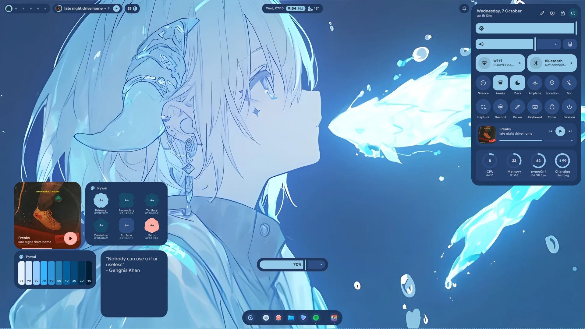

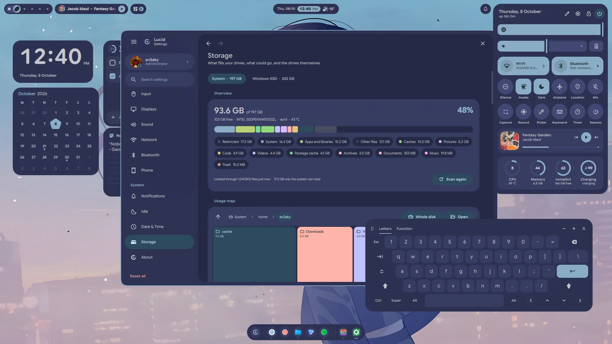

### Lucid 2

<!-- picture:  -->

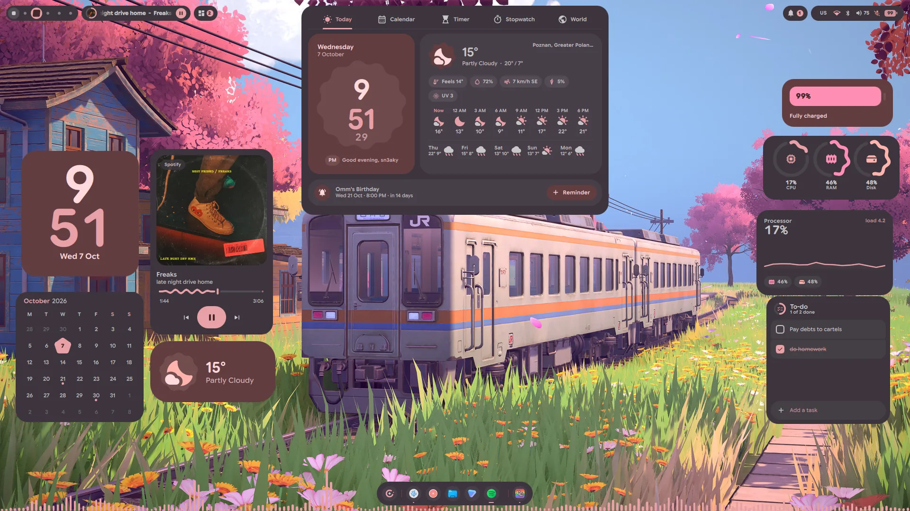

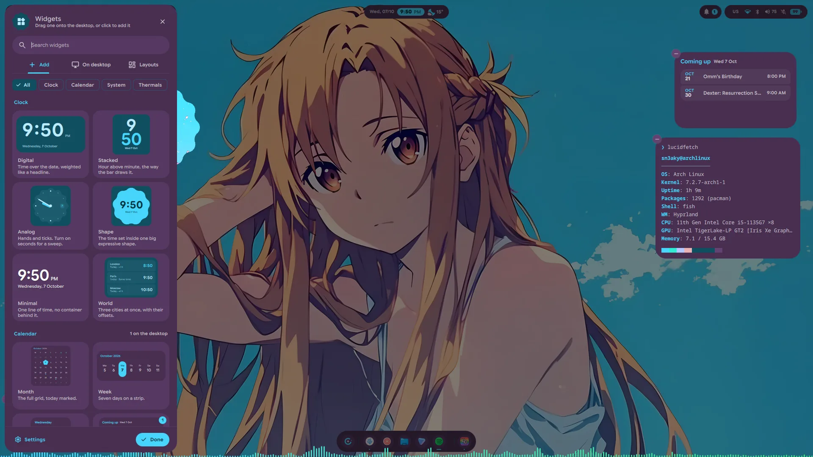

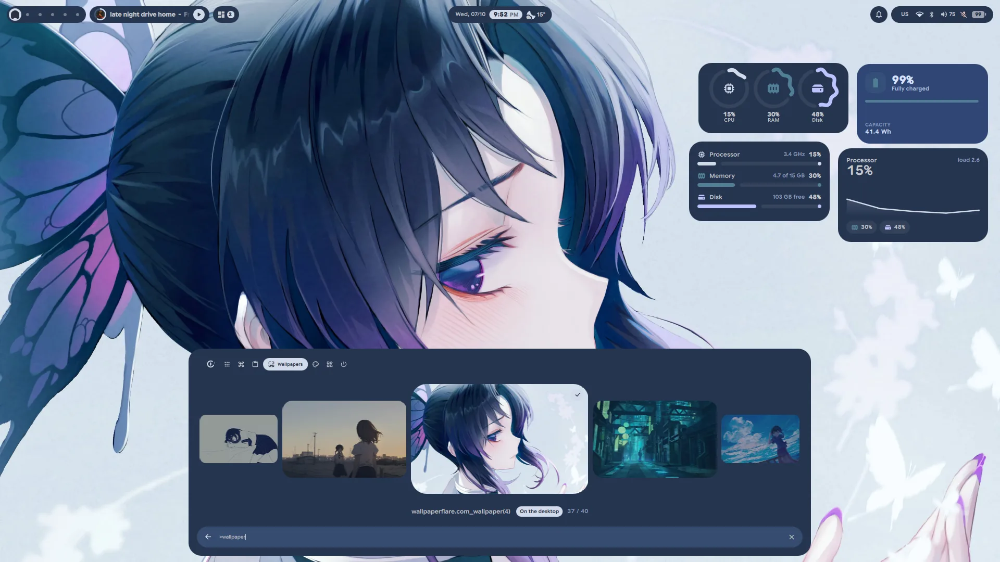

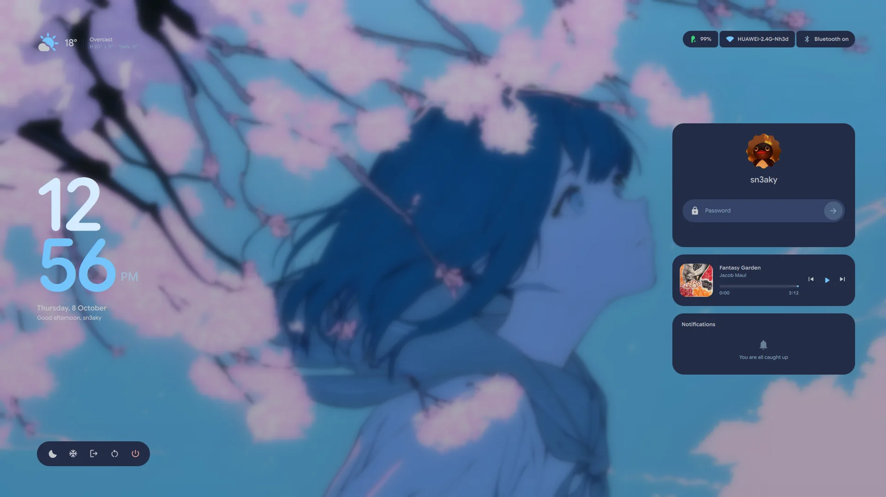

- **What's new, in the shell.** The first start after an update opens a sheet
  with what the new version brings, once; *Settings → About → What's new*
  opens it again, and `qs ipc call updates whatsnew` too. A newer release
  waiting to be installed still links its notes on GitHub from the same card.
- **Material You Expressive, everywhere.** The bar, dock, launcher, control
  centre, clock, widgets, OSD, toasts, lock screen and settings now share one
  kit of controls (`lucidui/`): buttons, chips, sliders, switches, tabs, text
  fields, list items, loading indicators and the expressive shapes. Icons are
  Material Symbols drawn from Google's own paths, multisampled so they stay
  clean at the smallest sizes, and text is set in Google Sans Flex, bundled
  under its OFL licence.
- **Interface size.** *Settings → General → Size* scales the whole shell at
  once, from 75 to 125 %: the bar, dock, panels, menus, desktop widgets and the
  text in them. Apps and the monitor's own scale are left as they are. Widgets
  keep their place against the edge or corner they sit nearest, and the new
  size applies when the slider is let go.
- **Progress waves.** Timers, the stopwatch, the media disc and the session
  screen draw their rings the M3 Expressive way: the active arc waves, the track
  stays still.
- **A session screen.** SUPER+Escape opens lock, suspend, log out, restart and
  shut down in one full-screen sheet. The three that end the session need a
  second press within four seconds.
- **A window switcher.** CTRL+ALT+TAB lays out every open window on every
  workspace, the special ones included, newest first and with live previews.
  As on Windows it stays up once the keys are let go: Tab or the arrows move,
  Enter switches, Delete closes the window and Esc backs out. CTRL+ALT+TAB
  again steps on; with SHIFT it steps back.
- **Password beads.** On the lock screen, in the polkit prompt and on the login
  screen, each character typed drops a Material Expressive shape that melts
  into a dot. A selection gathers its beads into one band, and Ctrl+A sweeps it
  across from the left. The shapes are androidx's own MaterialShapes, worked
  out from the same numbers rather than drawn by eye.
- **The lock screen grows out of your desktop.** Locking takes a picture of
  each display first, so the lock starts as exactly what was on screen, which
  frosts, sinks into a card and gives way to the wallpaper. Unlocking runs it
  back: the cards fall away, the desktop rises through the frost, and the last
  moments fade straight onto your live windows.
- **Workspaces as shapes.** The workspace pill's resting look: an empty
  workspace is a dot, one with windows a square, the one you are on a new
  Material shape on each visit, and neighbouring busy workspaces join into one
  run. The pill stretches from one to the next, and the marks under it take its
  ink exactly. Hovering still brings the numbers.
- **The clock is an app.** Behind the pill: Today, with the weather and what is
  next; a month calendar with reminders; countdown timers and a pomodoro; a
  stopwatch with laps; and world clocks. Whatever is counting shows on the pill
  as a chip with a ring, and the timers are shared with the Timer widget and the
  control centre's Timer tile.
- **The pomodoro has options of its own.** The tune button on its card opens
  them in place: four presets (25 / 5, 50 / 10, 15 / 3, 90 / 20), a stepper for
  each length and for the rounds, and a daily goal the card counts toward.
  Breaks and focus sessions can each start by themselves or wait for you, a set
  can stop after its long break instead of repeating, and do-not-disturb can be
  held for as long as a focus session runs. A phase in hand takes another
  minute from the card, or any number over IPC (`timer pomodoroAdd`, beside
  `pomodoroSkip` and `pomodoroStop`). The same options sit under *Pomodoro*
  on Settings' Date & Time page.
- **Every widget is rebuilt**, and four new ones join them: Timer, At a Glance,
  Photo and Fetch. A widget's right-click menu is a new sheet with live previews
  of its looks.
- **A widget panel.** Right-click the desktop and choose *Widget Panel*, or pick
  Widgets in the launcher's mode bar: a sheet slides in with every widget drawn
  live. Drag one straight out to where it should sit — it snaps like any card —
  or click it into the first free spot. It searches by name or by what a widget
  does, lists what is already out (hover to find a card, click for its sheet,
  lock or remove it) and switches layouts. While it is open the cards come up
  over your windows with a − on each, and a card dragged onto the sheet is
  taken off. `qs ipc call widgets panel` toggles it.
- **The launcher** gains a head band with its modes, the calculator's answer as
  a card at the top of the results, and prefixes: `?` for the web, `$` to run a
  command in your terminal and `:` for emoji. Apps can be hidden from it, and it
  has a page of its own in Settings.
- **Control centre tiles are yours to arrange.** *Edit tiles* lets you drag
  them into any order and add or remove them from a shelf of spares; the
  sliders ease as they move.
- **Switching wallpaper no longer stalls the desktop.** The colours are worked
  out at low priority, one run at a time with the newest request winning, and
  the shell crossfades its own palette alongside the picture. Browsing the
  wallpaper strip works out colours only for the picture you stop on, and
  kitty, VSCodium, Discord, Spotify, Steam, GTK and the login screen follow
  once, a few seconds later. The strip opens from small cached copies rather
  than decoding every original, 8K ones included, each time.
- **Window borders follow the palette**, and the starship prompt takes the
  palette's colours without its format being replaced.
- **A Storage page.** *Settings → Storage* shows what fills each drive, by kind
  and as a map you can zoom through from your home folder or the whole disk,
  what could go (package caches, old trash, duplicates and large files in your
  own folders) with a confirm for each, and the drives themselves with their
  health. It warns when space runs low and can empty trash after a number of
  days. The bar's disk card and the System widget now count free space as `df`
  does, leaving the root reserve out.

### Sounds

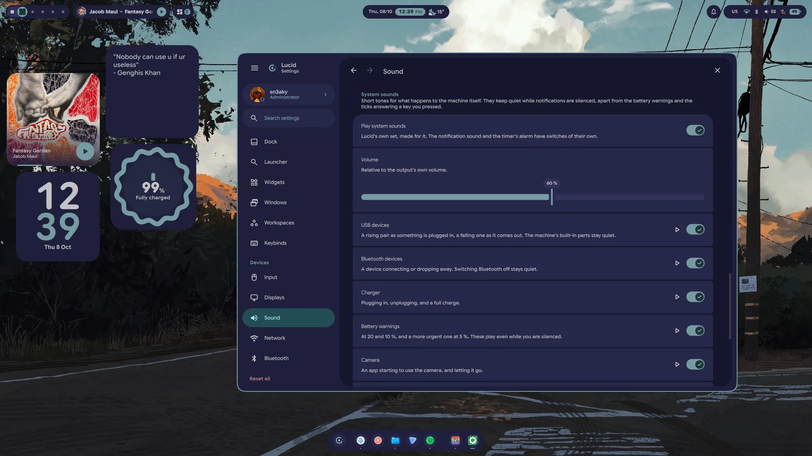

- **Lucid has sounds of its own.** The freedesktop bells and drops are gone;
  every sound is synthesised — FM bells, plucks, blips and sweeps, nothing
  recorded — by `support/sounds/build-sounds.py`, all in one key and levelled
  to one loudness, so a volume you set means the same thing for each.
- **Eight notification sounds**: Glint, Pulse, Chime, Tap, Orbit, Halo, Beacon
  and Alert, picked from chips that play as you choose. A saved freedesktop
  choice carries over to its nearest match.
- **System sounds** for a USB or Bluetooth device connecting and leaving, the
  charger going in and out, a full charge, low and critical battery, the camera
  turning on and off, and a screenshot. *Settings → Sound → System sounds* has
  a switch and a play button for each, and one volume for all of them. They
  keep quiet while you are silenced, apart from the battery warnings. The timer
  and pomodoro alarm is new as well, and **reminders ring out loud** now —
  they used to arrive in silence — with a switch and a play button for each
  under *Settings → Date & Time → Timers*.
- **Tiny ticks for your own keys**: volume and brightness tick at the level
  just set — where a drag or a held key starts and where it stops, not at every
  step — and Caps Lock and the microphone answer on and off. Dimming while you
  are away stays quiet. They start from [Kenney](https://kenney.nl)'s Interface
  Sounds (CC0).
- **A toast for USB devices**, named and drawn as what they are — a phone, a
  mouse, a drive. The laptop's own built-in parts stay quiet, a hub full of
  devices is one toast, and a device that drops and comes straight back is not
  news.
- **Camera on and camera off**, with the app using it, the way Windows 11 says
  so. Nothing polls for it: the camera's device is watched for being opened and
  closed. With the Privacy module on the bar, its own camera toast folds into
  the same pill.
- `qs ipc call -- sounds play <name>` plays any of them; `sounds list` names
  them all.

### From Ciro Rivera

Ciro wrote everything in this section, and a good deal of 1.10.5 besides. The
pull requests arrived tested, explained and ready, and the shell is better in
places nobody had asked about yet. A huge thank you, @ciroenrique4-eng.

#### Settings

<!-- picture:  -->

- **Search every setting.** A field at the head of the settings rail searches
  every row on every page, not just the page names: the results say which card
  a row sits in, and opening one scrolls to the row and flashes it. `Ctrl+F`
  focuses the field, typing anywhere starts a search, and
  `qs ipc call -- settings search <words>` opens Settings with the search typed.
  It replaces the rail's filter. By Ciro Rivera in #34.
- **A Windows page for Hyprland.** Gaps, border width and colour (none, the
  accent, or a gradient through the palette, which follows the theme), corners
  and their shape, shadow, dimming; the tiling layout with each layout's own
  options and a live preview; and focus, the cursor, resizing, snapping and
  animations. Only what you change belongs to Lucid, it applies without a
  reload, each row's reset hands the option back to your own config, and a file
  of yours required after Lucid's still wins, with the row saying so. By Ciro
  Rivera in #46.
- **An Input page for Hyprland.** Keyboard layouts in order, picked from every
  layout and variant the system knows; the key that switches them; what Caps
  Lock does; key repeat and Num Lock. Mouse speed, acceleration, scrolling and
  left-handed buttons; the touchpad's tapping, scrolling and palm rejection; and
  how the workspace swipe feels. By Ciro Rivera in #47.
- **Corner rounding.** One dial under *Settings → General → Shape*, from square
  to half as round again as shipped, live: cards, panels, menus, the bar's and
  the dock's pills, buttons, chips, switches and the search fields all follow
  it, while avatars, dots and the like stay round. By Ciro Rivera in #18.

#### Colours and palettes

- **Templates follow every palette.** The matugen templates that carry the
  palette into other applications (Hyprland, Zen, rofi, waybar, pywalfox and
  your own) used to follow only the wallpaper; the fixed themes and pywal reach
  them too now. They render one at a time, so one broken template no longer
  breaks the others, and what happened to each is recorded, with a toast naming
  any that failed. By Ciro Rivera in #36.
- **A Colours page.** Matugen's scheme style (nine of them, from Tonal to
  Monochrome), its contrast, and which of the wallpaper's dominant colours the
  palette starts from. **Your colour** is a new theme built from a single colour,
  typed as hex, picked off the screen or chosen from a few. Below that, every app
  template with how its last render went, a switch for each, the apps that are
  installed but not wired up yet, and a form for a template of your own that you
  can try before adding. By Ciro Rivera in #38.
- **A Palettes page.** A gallery of the 560 base16 and base24 schemes
  tinted-theming collects, drawn in their own colours, searchable and filtered
  by dark or light, one click to add or use. Themes import from a repo or a
  file, light schemes are finally kept light (with a dark side worked out for
  them), and the palette on screen can be edited live and exported as a Lucid
  palette or base16 YAML. By Ciro Rivera in #40.

#### Bar

<!-- picture:  -->

- **Arrange the bar from Settings.** *Settings → Bar → Modules* shows the bar's
  three groups as lanes: drag a module along its lane or into another one, or
  use the arrow keys. Each module has a card with its switch, the group it sits
  in and a way to the rest of its settings, and a right click on a module in the
  bar opens its card. By Ciro Rivera in #44 and #50.
- **Three new modules**, all off until you switch them on. **Privacy** appears
  only while something uses the microphone, the camera or the screen, says which
  app, and can raise a toast as it starts. **Power** holds lock, suspend,
  hibernate, log out, restart and shut down, in the order you pick, under the
  machine's uptime. **Active window** shows the focused window and, opened,
  floats, pins, fullscreens, moves or closes it, or switches to another window
  on the workspace. By Ciro Rivera in #50.
- **Looks and options for the bar's own modules**, each on its card, every one
  starting from how the module already looks. The clock: one line or two lines
  beside the accent chip, and four ways to write the date. Media: a still cover
  or just the bars and the play button, a large-cover panel, and switches to
  hide it while nothing plays, drop the artist, cap the title's width, hide the
  play button and turn the volume wheel off. Workspaces: numbers instead of
  dots, how many always show, and the wheel on or off — the wheel switches
  workspaces now, which it never did. Notifications: a dot, or bell and count on
  an accent chip. The tray: every app's icon in the bar, the icons in the
  palette's colours, and a switch per app to keep it out. By Ciro Rivera in #50.
- **A bar on every display.** *Settings → Displays → The bar on its own →
  Every display* (or `qs ipc call -- displays bar all`) gives each screen a bar
  of its own, with that screen's workspaces. Notification popups, the privacy
  toast and the bar's ipc still come from one of them: the shell's display, or
  the one you are on. By Ciro Rivera in #14.

#### Launcher

<!-- picture:  -->

- **One search for everything open and everything to do.** Typed text now
  finds open windows by their app or their title (Return switches to it), apps'
  own actions like *New Private Window* (listed under the app when you type its
  name), and lock, suspend, log out, restart and shut down from three letters,
  ranked together with the apps and the commands. Restart, shut down and log out
  ask for a second Return. A typed address gets a row of its own at the top when
  nothing matches it better. Each has a switch under *Settings → Launcher*,
  beside a line under each app from its desktop entry (off to begin with). By
  Ciro Rivera in #17.
- **Power buttons by the search field**, off to begin with: pick which of lock,
  suspend, log out, restart and shut down show while nothing is typed. The ones
  that end the session turn red on the first press and act on the second. By
  Ciro Rivera in #17.

#### Sound and the phone

- **The Sound page shows what a device is doing.** A live level meter under the
  output and the microphone volume (so a dead microphone reads apart from a
  quiet one), balance for a stereo output with a way back to the centre, a
  Left/Right test, an app put back on the default device, and a Behaviour card
  for WirePlumber's own settings: remembering each app's volume and device,
  following the default, pausing when a device goes away, headset call mode and
  mono audio. The meters have a switch of their own. By Ciro Rivera in #11.
- **The phone widget** browses the phone's files (with a switch for the
  button), greys out what the phone has switched off and says why when tapped,
  says what an action just did, and with more than one phone paired steps to the
  next and remembers it. By Ciro Rivera in #15.

#### Control centre

- **Night light.** hyprsunset warms the screen, fading in and out, by hand, from
  sunset to sunrise where you are (worked out locally, with no network) or
  between hours you set. Switching it while a schedule runs holds until the
  schedule next changes. Add the *Night light* tile with *Edit tiles*;
  right-click it for the warmth and the schedule. Settings → Displays and
  `qs ipc call nightlight` reach it too. By Ciro Rivera in #53.
- **The disk card counts LVM and LUKS volumes.** A root on LVM read as
  *0 / 477 GB*; volumes now count toward the disk they live on, and a btrfs
  partition with several subvolumes mounted is counted once rather than once
  per subvolume. By Ciro Rivera in #27.

#### Screenshots and recording

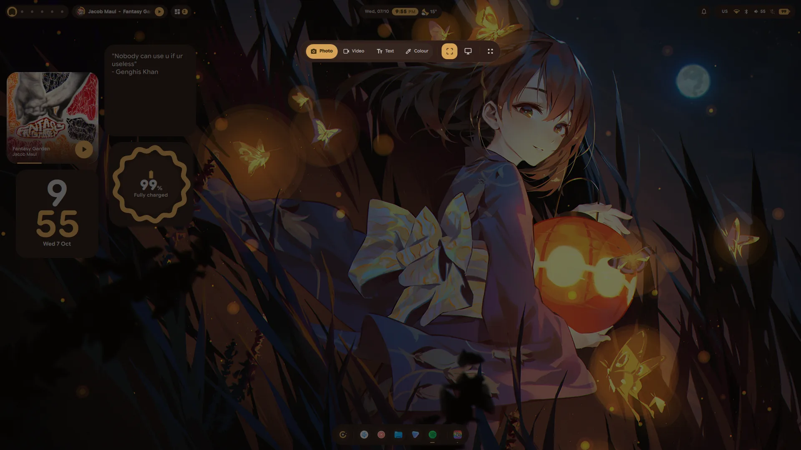

<!-- picture:  -->

- **A preview card after each capture**, in the corner of the display you
  captured: click to open, drag it into any app that takes files, or copy, mark
  up, show in its folder or delete (twice) from its buttons. Recordings get one
  too, with their length. Settings → General → Screenshots picks the card, the
  old notification or nothing. Screenshots also save about three times faster.
  By Ciro Rivera in #52.

#### Network, workspaces and the clipboard

- **Share a Wi-Fi network as a QR code**, from its row in Settings → Network or
  the bar's Wi-Fi panel, the way phones do it. The password shows on request and
  copies without landing in the clipboard history. By Ciro Rivera in #51.
- **Special workspaces** can blur what is behind them, keep a margin from the
  screen's edges so they sit like a card, and be made by you: a name, a mark,
  the apps it brings up and a key of its own. By Ciro Rivera in #45.
- **The clipboard history has a preview pane**: an image at full size, text in
  full, a colour as a large swatch. Entries are sorted into images, colours,
  links, addresses and text, and `Ctrl+Shift+Del` twice clears the lot. By Ciro
  Rivera in #10.

#### Fixed

- **The charger and low-battery toasts never fired**, and the *Preview* button
  under Notifications → System events did nothing. By Ciro Rivera in #25.
- **Log out did nothing on a Lua config**, from the session screen, the lock
  screen or SUPER+M: `hyprctl dispatch exit` is not a dispatcher there. It tries
  `hl.dsp.exit()` first now. By Ciro Rivera in #30.
- **The bar clock's AM/PM** is the locale's own now ("P.M.", "午後"). Ciro found
  it doubled outside English locales in #29.
- **Bluetooth devices that drop two seconds after connecting**, over and over:
  an adapter that is not pairable lets the pairing through but throws its key
  away. Pairing now holds pairable on until it is done. By Ciro Rivera in #9.
- **A region or a recording on a second display** came from the wrong place, or
  recorded both displays. By Ciro Rivera in #8.
- **The installer offered to restart a shell that was not running**, and did,
  with plain `qs`. By Ciro Rivera in #7.

### Contributed

- **Workspaces that say which display they are on.** With two or more displays
  the bar's dots fall into one run per display, each led by the display's number
  on hover, the accent follows the display you are on, and the overview lays out
  one block per display. *Settings → Displays → Workspaces → Group by display*
  turns it off; one display looks as it always did. By @MrZtone in #54.
- **The installer names what a replaced `hyprland.conf` sourced**, since a Lua
  config cannot read those files, and the README gives the xray layer rule in
  Lua. By @arbelonson-source in #5.

### Performance

- **About 150 MB less memory at rest** (790 to 639 MB resident on an Iris Xe
  laptop). The bundled font keeps only the three axes the shell varies, 4.15 MB
  down to 569 KB; the launcher, the settings window and the emoji picker are
  built the first time they are used rather than at start-up; and an unused
  NVIDIA driver is no longer loaded on a machine without an NVIDIA card.
- **The bar no longer redraws at 60 fps on an idle desktop.** Every looping
  animation in it now stops while it cannot be seen. Thanks to
  @theheavenlyhacker, whose measurements in #43 showed what it was costing.
- **Hyprland no longer freezes for five seconds while a window resizes.** The
  OSD asked Hyprland for the lock keys; it reads the keyboard's own LEDs now.

### Installer

- New packages: `hyprsunset` (night light), `qrencode` (Wi-Fi codes),
  `xdg-terminal-exec` (the launcher's `$` mode), `inotify-tools` (the camera
  on/off toast), `sshfs` (browsing a phone's files), `pipewire-audio` with
  `sound-theme-freedesktop` (the Sound page's Left/Right test), and
  `smartmontools` and `udisks2` (drive health and mounting on the Storage page).
- **Google Sans Flex** is installed to `~/.local/share/fonts/lucid` for the apps
  the Environment page dresses, and beside the SDDM theme, which now draws in it
  the way the lock screen does.
- **Hyprland:** `modules/settings.lua` applies what the Windows and Input pages
  set, and `modules/plugins.lua` holds plugin settings, each applying only while
  its plugin is loaded. It ships with the tilting cursor of
  [hypr-dynamic-cursors](https://github.com/virtcode/hypr-dynamic-cursors); the
  installer offers to build it (`--no-plugins` skips that) with
  `scripts/cursor-plugin.sh`, against the headers the hyprland package installs
  and without root. `modules/autostart.lua` runs the same script on every login,
  so the cursor is still there after a restart, and is rebuilt by itself after a
  Hyprland update.
- The theme scripts behind the Colours and Palettes pages go into
  `~/.config/lucid` with the rest.
- **The login screen wears whoever is picked.** Each account paints its own
  wallpaper and palette into the SDDM theme, and choosing another account in
  the user picker crossfades the greeter to theirs. Before, the installer handed
  the whole theme to whichever account ran it last, and every other account's
  wallpaper changes were dropped without a word. The theme now stays root's,
  with one sticky `users/` directory each account writes only its own part of,
  and an account the greeter has nothing for yet is painted at its next login.
- **Settings' file choosers no longer need zenity.** Picking an account
  picture, a wallpaper, a template or a palette did nothing at all without it.
  They now open the desktop's own chooser through the XDG portal, with zenity
  and kdialog as fallbacks and a notification when none is there, and they float
  instead of tiling.
- Restarting the shell at the end of an install goes through `launch-shell.sh`,
  as a login does, so it comes up on the same render backend.
- **SUPER+R restarts the shell as well**, as its keybind always said: Hyprland
  reloads, the shell stops cleanly and comes back through `launch-shell.sh`.
  The calculator (F12) opens as a small floating window rather than tiling,
  and with more than one keyboard layout Alt+Shift switches between them
  (*Settings → Input* picks another key).

### Upgrading

```sh
git pull
./install.sh
```

- **Your bar keeps its layout.** The six module switches from 1.10.5 carry over,
  and every module stays in the group it was in until you move it.
- **Your keybinds are yours**: the installer only seeds `keybinds.json` when it
  is missing, so three shipped changes need adding by hand under Settings →
  Keybinds. SUPER+Escape opens the session screen (`qs ipc call session
  toggle`), CTRL+ALT+TAB opens the window switcher (`qs ipc call switcher
  next`, and `qs ipc call switcher prev` on CTRL+ALT+SHIFT+TAB), and SUPER+M
  should run
  `command -v hyprshutdown >/dev/null 2>&1 && hyprshutdown || hyprctl dispatch 'hl.dsp.exit()'`.
- **A Hyprland config of your own** gets `require("modules.settings")`
  appended, the same way `modules.glass` is, so the Windows and Input pages can
  apply what they set.
- **The login screen** needs the theme reinstalled once, as root, to move to
  per-account copies: `./install.sh` does it and paints your own account
  straight away, or on its own `sudo support/sddm/install-theme.sh`. Any other
  account that uses Lucid needs `./install.sh` run once as itself too, since
  an older `sync-sddm.sh` cannot write to the new theme. Each account then
  shows up as itself after its next login or wallpaper change.

## v1.10.5 — 2026-09-22

The shell disappeared after a restart. This release fixes that.

### Fixed

- **The shell starts on login again.** After a reboot or a new login, the
  wallpaper came back but the bar, dock and widgets did not, and re-running
  `install.sh` was the only way to get them back. The line in
  `modules/autostart.lua` that starts the shell opened with `[ -x … ]`, and
  Hyprland reads a command that opens with `[...]` as exec rules (as in
  `[workspace 2] kitty`), so it ran nothing, silently. It uses `test -x` now.
  Found by @ciroenrique4-eng in #28.

### Contributed

These came in with 1.10.5 as well, all written by Ciro Rivera
(@ciroenrique4-eng).

- **Edit Hyprland's binds from Settings.** `modules/binds.lua` reads its binds
  from `~/.config/lucid/keybinds.json`, one entry per line, so a broken entry
  costs that bind rather than every bind; a missing file binds a small
  emergency set. *Settings → Keybinds* lists, searches, edits, adds, disables
  and deletes them, and SUPER+/ shows the whole sheet over the screen. #23
- **Toasts for what the machine does on its own**: the keyboard layout, game
  mode, the charger and the battery, Bluetooth devices, Wi-Fi, the audio output,
  displays and the power profile, each with a switch under Notifications →
  System events. The toast queues them rather than letting one cut off another.
  #21
- **Four widgets**: Thermals (the graphics card, its fans and the power
  profile), Network (a minute of traffic, the connection in detail, or down and
  up), Games (your Steam library, one click from playing) and a Timer. #20
- **The control centre** shows the keyboard layout on its compact strip (click
  it to switch), and gains a power profile tile and a game mode tile. #19
- **Workspaces that belong to a display**: shared as before, or one display per
  workspace, split evenly or picked by hand, under Settings → Displays. #13
- **Pick a display off the map**: the arrangement map shows with one display
  too, a click scrolls to that display's settings, and *Identify* puts its
  number, name and mode on the screen itself. #12

### Upgrading

Pull and re-run. The installer replaces `~/.config/hypr/modules/autostart.lua`
with the fixed one.

```sh
git pull
./install.sh
```

If you kept your own Hyprland config when the installer asked, nothing in it
starts Lucid. Add this to `~/.config/hypr/hyprland.lua`:

```lua
hl.on("hyprland.start", function ()
    local launcher = os.getenv("HOME") .. "/.config/lucid/launch-shell.sh"
    hl.exec_cmd("test -x '" .. launcher .. "' && exec '" .. launcher .. "' || exec quickshell")
end)
```

## v1.1.0 — 2026-09-17

Everything the shell asks you for, it now asks for itself: a lock screen that
checks your password through PAM, the administrator prompt for the whole
machine, the accounts on it, and a login screen wearing the same palette. Around
that, a notification centre that groups and replies, clipboard history in the
launcher, a keyboard you can type with when there is not one, and a light mode
built rather than inverted.

### Lock screen

- **The lock screen is rebuilt from scratch.** The old single 1000x600 card
  packed with weather, disk charts, CPU and RAM graphs and a fastfetch dump is
  gone. In its place the content floats on the wallpaper the way Material You
  lays out a lock screen: an oversized two-line clock in the wallpaper's own
  accent colour on the left, the weather above it, the glanceable chips top
  right, and a right-hand column carrying the sign-in card, what is playing and
  the notifications.
- **It authenticates through PAM.** The old screen shelled out to
  `sudo -S -v`, which only worked for accounts that happen to be sudoers and
  told you nothing when it failed. The lock now opens a real PAM session
  against `/etc/pam.d/login` — the same service a display manager uses — so any
  account can unlock, and PAM's own words are what you read when something goes
  wrong. A second question from PAM (a token, a second factor) reopens the
  field with PAM's prompt on it rather than dead-ending.
- **The refusals say something useful.** "Incorrect password — 2 tries left"
  counting down against faillock's real `deny`, "Too many attempts — try again
  in 8 minutes" with the countdown read from `faillock` itself, "The check
  timed out" when PAM stops answering, and PAM's own sentence when it has one.
- **Caps Lock gets its own badge** next to the field, so the commonest reason a
  password is refused stays visible even while a refusal is on screen. The
  active keyboard layout shows beside it when you are typing.
- **Two faces, one screen.** Resting, the lock is a glance: clock, date,
  greeting, weather, media, notifications. Touch the keyboard and it focuses —
  the wallpaper blurs further, the clock shrinks out of the way, everything
  that is not the field steps back, and the sign-in card is all that is lit.
  **What steps back also goes inert** — while the field has the screen, the
  media card, the notifications, the power bar and the glance chips take
  neither clicks nor hover: no pill opens, no button lights up, and a click out
  there buys the focus back rather than pressing whatever was under the
  pointer. It drifts back to the glance after half a
  minute of quiet.
- **The password field is an M3 outlined field**: a focus ring in the accent,
  beads that pop in per character, a reveal toggle, and a submit button that
  turns into a proper indeterminate spinner while PAM thinks and a tick when it
  opens. The lock glyph turns over on success; the pill and the avatar's ring
  go green, or red and shake.
- **Power actions ask first.** Log out, restart and shut down morph the bar
  into a confirmation instead of going straight through; suspend and hibernate
  still go immediately. The question withdraws itself after seven seconds.
  Hovering one opens it into its own labelled pill inside the bar — the glyph
  stays put, the bar grows around it — rather than floating a tooltip over the
  wallpaper.
- **A caret you can steer.** The beads are not just a count: a caret sits where
  the next character will land, and the arrow keys walk it back through what is
  already typed so a single character can be fixed instead of starting over.
  Each new bead is left behind *by* that caret — it starts as the caret's own
  line and settles into a dot where it stood.
- **Clicking away puts the lock back to rest.** Anywhere off the sign-in card
  drops the focus, forgets what was half-typed and clears any refusal still on
  screen; the card itself counts as inside, so clicking the avatar aims the
  keyboard at the field instead.
- **Notifications on the lock cannot reach past it.** Their action buttons and
  inline reply are hidden, and `Notifs` refuses to invoke an action or send a
  reply while the session is locked, so no card can launch or talk to an
  application from the lock screen.
- **Every other screen gets the clock**, not a second password field.
- **Arriving and leaving are different gestures.** The entrance is a staggered
  wave read off a single number: the wallpaper settles out of a push-in and
  blurs, the clock rises in from the left, and the right-hand cards slide in
  one after another. Leaving is not that run backwards — the whole stage leans
  forward and dissolves at once while the wallpaper comes back into focus.
- **New layout of the code.** `Lockscreen.qml` is a root singleton holding the
  session state, PAM, the attempt ledger and the IPC; `lucidlock/` is eleven
  small views instead of one 3000-line file. `lucidlock/BlurBackdrop.qml`, which
  nothing had used for a long time, is gone.
- `qs ipc call -- lock` keeps `lock`, `unlock` and `isLocked`, and gains
  `status` (the session state as JSON). Nothing bypasses the password: the
  scaffolding used while the screen was being built — a dry-run mode, and
  handles that could force a verdict — is gone, so PAM is the only way in.

### Authentication

- **Lucid is the session's polkit agent.** Anything on the machine that needs
  an administrator — mounting a disk, changing the time zone, installing a
  package, `pkexec`, the Users page — now asks through a Lucid dialog instead
  of the KDE one. Only the dialog is ours: polkitd still decides what needs
  authorising and PAM still checks the password, through polkit's own setuid
  helper. Nothing about the security model changes.
- **The dialog says what is actually being asked.** A badge glyph picked from
  the action itself (a disk for udisks, a power symbol for logind, a terminal
  for `pkexec`, a parcel for package installs), the action's short description
  from `pkaction` as the headline, and polkit's own sentence underneath —
  retyped out of its `like this' quoting into real quotation marks.
- **It shows whose password it wants.** Every identity polkit will accept is
  listed with the name and picture from the Users page, and when there is more
  than one, picking a different administrator re-points the request at them.
- **The field is the lock screen's field** — the same pill, focus ring and
  reveal toggle — so a password prompt looks the same wherever the shell asks
  for one. A refusal tints the pill, shakes it and says what PAM said; a grant
  shows a tick before it leaves.
- Escape, the Cancel button and a click on the dimmer all dismiss the request
  properly, so whatever asked is told it was refused rather than left waiting.
  The dialog holds the keyboard only while a request is actually live.

### Users and accounts

- **The settings app manages the machine's user accounts.** A card at the top of
  the navigation rail shows your picture and name and opens a new *Users and
  Accounts* page, where every account on the machine is listed and picking one
  points the whole page at it.
- **Full name, username, account type, login shell, email and location** are all
  editable, with the guards that matter: the last administrator cannot demote
  themselves, an account that is signed in cannot be renamed, and you cannot
  lock or clear the password of the account you are using.
- **Passwords** are set through a dialog that checks the two entries match and
  rates what you typed, and a password hint can be left alongside. An account
  can instead be told to choose its own password at its next sign-in.
- **Accounts can be added and removed.** Adding asks for a name, guesses the
  username from it, and offers to set the first password now or leave it for
  first sign-in. Removing makes the files a separate, explicit decision from the
  account itself.
- **Account pictures** can be chosen from the machine's stock faces or any image
  on disk; it is centre-cropped and scaled to 256 px, saved to `~/.face` for
  your own account so the lock screen finds it, and can be removed again to fall
  back to initials on a tonal disc.
- **Supplementary groups** — audio, video, libvirt and the like — are shown as
  chips you can toggle, batched into one authorisation rather than one per group.
- Everything privileged goes through AccountsService on the system bus, so the
  session's polkit agent does the asking and the shell never runs as root. A
  refused or cancelled prompt is reported on the page instead of failing
  silently. Requires `accountsservice`, now declared in the installer.
- **Account pictures keep a history.** Changing your picture files the old one
  away rather than losing it, and the picker shows what the account wore
  before, newest first — clicking one puts it back. Removing a picture keeps it
  too, so going back to initials is never a one-way door.
- The shelf holds twelve pictures or 8 MB, whichever runs out first, and the
  oldest drop off as new ones arrive. Pictures are stored by what they look
  like, so re-applying one already there just moves it to the front instead of
  filing a second copy. **Clear** empties the whole shelf.
- The history lives in your own data directory, so reading it never asks for an
  administrator.
- **Passwords now need four characters rather than six**, in the password
  dialog and when adding an account. The strength read-out is unchanged, so a
  short password is allowed but still reads as weak.
- Fixed: a face directory's own hidden fallback silhouette (SDDM ships one as
  `.face.icon`) was being offered as a stock picture, showing up as an empty
  black circle in the picker.

### Notifications

- **The notification centre is rebuilt.** One place now owns every notification
  in the shell — the pill on the bar, the popups and the lock screen are three
  views onto the same list, so dismissing something dismisses it everywhere and
  Do Not Disturb means the same thing wherever you turn it on.
- **Notifications group by application.** Five messages from one chat collapse
  into a single stack with the application's name on it; open it to read them,
  clear it to drop the lot. A heading separates what has just arrived from the
  rest, and each card says how long ago it came.
- **You can answer without leaving what you are doing.** Applications that offer
  an inline reply get a message box on the notification itself.
- **File copies, downloads and transfers report how far along they are**, as a
  bar that fills in place rather than one notification per percent.
- **Popups stack under the bar.** The newest grows out of the pill itself and
  the rest float beneath it; hovering the stack freezes every countdown at once,
  and anything past the limit waits in the list instead of racing past. A swipe
  up sends a popup back to the bar, a swipe sideways clears a card from the list.
- Grouping, timestamps, progress, inline reply and how many popups show at once
  are all switchable on the Notifications page.
- `qs ipc call -- notifs open|close|toggle|clear|toggleDnd|expandAll|count`.

### Control centre

- **The System pill's job is narrower and what is left goes deeper.** The
  notifications preview is gone from it — the Notifications pill owns that list
  — and what remains is device state and quick settings.
- **Audio devices can be switched from it.** A chevron on the volume and
  microphone rows slides in the outputs or the inputs, named the way you would
  name them — "Speaker", "HDMI 1" — rather than by the chipset four of them
  share. A socket with nothing plugged into it says "Not connected" and cannot
  be picked.
- **A Caffeine tile**, so the idle ladder can be held off without opening the
  settings app.
- CPU temperature, uptime, memory in gigabytes, and on a laptop what the battery
  is actually drawing.
- The player card stays, redesigned: album art, title and artist, previous and
  next either side of a filled play button, and a progress bar that moves.

### Clipboard history

- **The launcher remembers what you copy.** `SUPER` + `SHIFT` + `V`, or `>clip`
  in the search field, lists what has been through the clipboard, newest first —
  pick one to put it back.
- **Images are kept too**, and preview on their row.
- `Delete`, or the button on the row, drops one entry; *Clear history* on the
  Dock settings page drops all of them; the switch beside it turns the whole
  thing off.
- `cliphist` is the store, and the shell owns the watchers that feed it — so
  history records for as long as the shell is running, not only while the
  launcher is open.

### On-screen keyboard

- **A keyboard for when there is not one.** `SUPER` + `K`, the desktop's
  right-click menu, the launcher's command list, or `qs ipc call keyboard
  toggle`.
- **It never takes the focus off what you are typing into**, and clicks outside
  the panel reach the application underneath — so the caret stays where you put
  it and you can aim at a field between keystrokes.
- A letters layer and a function layer; modifiers latch on one press and lock on
  two; Caps is kept to the panel so it cannot fall out of step with the real
  keyboard. Chords go out as chords, which is the only form some applications
  accept.
- Drag it anywhere by the strip along its top, and it stays where you left it.

### Light mode

- **The shell has a light mode**, under Theme in the settings app. The palette is
  rebuilt rather than inverted at the last minute: matugen and pywal re-extract
  the wallpaper in the mode you picked, and the themes that only ship a dark
  palette get a light one built from their own colours in tone space — Nord
  lands on its own Snow Storm, Gruvbox on its own cream.
- **The accent is applied to light surfaces.** A generated light palette is
  almost white, and no hue exists at all near tone 100 — so the ramp is first
  walked off white, then mixed toward the accent at each rung's own tone, which
  keeps the elevation ladder exactly as far apart as it was. The tint aims at an
  amount of colour rather than mixing a fixed fraction, so every theme lands in
  the same place: a near-grey Gruvbox and a vivid pywal both come out tinted
  rather than one staying white and the other turning mint. *Accent tint*,
  beside Surface darkness, controls how far.
- **The mode is remembered**, in `~/.cache/current_mode` beside the theme, so
  changing wallpaper keeps the mode instead of dropping back to dark.
- **Applications follow the shell.** Flipping the mode also asks GTK and Qt for
  it and swaps the GTK and icon themes to their light or dark counterpart —
  but only to a counterpart that is actually installed.
- Status colours, dim text, hover and pressed states, and every elevated
  surface now flip direction with the mode, instead of staying at the tone that
  only reads on a dark background.

### Login screen

- **SDDM gets a Lucid theme** — the lock screen ported to the greeter: the same
  two-tone clock, the same palette, the same wallpaper, blurred once in advance
  so the login screen is not running a blur on a cold GPU. The user and session
  pickers take the place of the glance chips, and the weather, media and
  notifications drop out, there being no session yet to read them from. It
  carries the lock's two faces too, including going inert while the field has
  the screen: the pickers and the power bar take neither clicks nor hover until
  a click hands the focus back.
- It is painted from the running shell's own resolved colours, so it follows a
  theme or wallpaper change like everything else does, and repaints without
  asking for a password.
- The installer copies it in when SDDM is present, but **never switches to it** —
  which theme greets you stays your call.

### Volume, brightness and the lock keys

- **The volume, brightness and microphone popups are redrawn** to the same
  anatomy the control centre's sliders use: a badge, a track that answers the
  keypress, and a readout. Mute is cut through the badge as a gap in the glyph
  rather than a line laid over it.
- **Caps Lock and Num Lock get a popup of their own**, showing the letters the
  next keystroke will make — `ABC` against `abc` — rather than the words on and
  off, and rolling from one to the other.
- **Toasts are snackbars**, to the Material 3 metrics, and a colour too dark to
  read against the pill is lifted until it is.

### Workspaces

- **Any installed application can be put on a scratchpad workspace**, not only
  the ones the catalogue knows about: *Add an app* on the Workspaces page lists
  everything on the machine, and works out what to match the window by.
- **The chips say what a stashed window is rather than who made it.** The
  application logos are replaced by a glyph read off the application's own
  categories — a terminal for a terminal, a note for an editor — drawn as
  vectors, so they stay sharp at any scale. Tucked away, only the front one
  shows; opening the chip fans the rest out behind it.

### Environment

- **The pointer's shadow can be turned off.** Hyprland has no switch for this —
  the shade is painted into the cursor theme's own images — so Lucid renders the
  theme again from its vector sources, copying every size, hotspot and frame
  delay exactly, and points GTK, Qt, XCursor and Hyprland at that copy. The
  pointer keeps its shape; only the shade goes.

### Performance

- **Animations run at the screen's refresh rate on NVIDIA.** Qt refuses threaded
  rendering on the proprietary driver — its own workaround for an old resize bug
  — and falls back to a render loop whose animation clock is a fixed 16ms timer,
  which pins every animation in the shell to ~60fps however fast the monitor is.
  Hyprland stays smooth throughout, which is why this looked like the shell
  being slow. Lucid now starts through `~/.config/lucid/launch-shell.sh`, which
  moves those machines to Qt's Vulkan backend, where the restriction does not
  apply.
- It only switches when NVIDIA is the card the compositor actually renders on,
  the driver is 555 or newer, and an NVIDIA Vulkan driver is present — a hybrid
  laptop rendering on Intel is left alone. `launch-shell.sh --explain` prints
  what it decided and why, without starting anything.

### Contributed

- **A KDE Connect widget** for the desktop, in three sizes: the phone's name and
  battery at a glance, a card with signal and charge state, and a remote. Files
  can be sent to the phone from it. Thanks to @k-k-j123.
- **A Sound page** in the settings app — output and input devices with what each
  one is, a volume for every application making or taking sound right now, and
  the choice of whether picking a new output carries what is already playing
  across to it. Thanks to @MrZtone.
- **Installer fixes:** the warning about an old Hyprland actually fires, a
  configuration the installer cannot read is no longer replaced without asking
  first, and `require` lines added to `hyprland.lua` by hand survive a refresh.
  Thanks to @arbelonson-source.

### Fixed

- Do Not Disturb could not be turned on from the System pill or the lock screen.
  Both wrote to a value that refused to be written, so the switch moved and
  nothing happened.
- Airplane mode never gave the radios back. It only ever turned Wi-Fi and
  Bluetooth off, so switching it off again did nothing; it now puts back exactly
  what was on before.
- The CPU reading in the System panel was wrong for a moment after opening it —
  the first sample averaged over the whole time the panel had been closed.
- The widget options menu opened underneath your windows when the cards are set
  to sit below them. It is drawn on its own layer now.
- Hyprland's autostart re-applied the GTK theme, the icon theme and a dark
  colour scheme on every login, overriding whatever the Environment page had
  been told and putting light mode's applications straight back into dark. The
  installer seeds those once when you ask for the Lucid look; the Environment
  page owns them from then on.
- `sync-sddm.sh` never ran and never reported that it had not. A misplaced
  `exit 0` meant it returned success without painting anything, so the login
  screen sat on a months-old palette; it was not installed by the installer
  either, and it exited silently on a machine without `/etc/sddm.conf.d`. All
  three are fixed, and matugen applies it now too.

## v1.0.5 — 2026-09-12

Multiple displays, properly: the shell sits where you put it, every screen is
configurable from the settings app, and a display coming and going no longer
takes the bar with it. Plus scratchpad workspaces on their own keys, glass you
can aim at one app at a time, widget arrangements you can save, and Lucid
telling you when there is a new version.

### Displays

- **A Displays page**, under Environment in the sidebar, for every screen the
  machine has: resolution, refresh rate, scale, orientation and adaptive sync,
  one card per output. Each card names the panel, its size and what it is doing
  right now, and only offers modes the display actually reports — so there is no
  way to pick one it cannot show.
- **Scale says what you get.** Each option is labelled with the room it leaves
  for windows, a scale that does not divide the panel evenly is called out as
  such, and scales that would leave less than 960px of width are not offered at
  all.
- **Displays are arranged by dragging them.** With more than one screen the page
  draws the layout the way Hyprland sees it; drag one and its edges snap to its
  neighbours, so there are no gaps for the pointer to fall into. *Arrange
  automatically* hands the placement back to Hyprland. Moving one display pins
  them all where they already are, so Hyprland cannot shuffle the rest around
  the one you moved.
- **A display can mirror another, or be switched off** — except the last one
  left on, which the page will not let go. The Hyprland module refuses it too,
  so a hand-edited config cannot black out every screen either.
- **The shell can be pinned to one display.** The bar, the dock, the volume and
  brightness popup and the toasts are one of each, and they all move together;
  widgets with no display of their own follow too. *Automatic* leaves the choice
  to Hyprland as before. The wallpaper, the desktop menu and the lock screen are
  drawn on every display either way. `qs ipc call -- displays shell <name>` does
  it from a keybind, and takes `here`, `next`, `prev` or `auto` as well;
  `qs ipc call displays list` says where it is.
- **Unplugging the display the shell was pinned to no longer takes the shell
  with it.** It moves to a display that is left, keeping the pick, so plugging
  back in puts it back where you had it.
- **The bar and the dock can each be sent to a display of their own**, for a
  setup that wants them apart — *The bar on its own* and *The dock on its own*
  on the same page, both *With the shell* by default. `qs ipc call -- displays
  bar left` and `displays dock middle` do it from a keybind.
- **A display can be named by where it sits**: `left`, `middle` and `right`
  work anywhere an output name does, as do `here` for the display in use and
  `next`/`prev`. `qs ipc call displays list` prints the outputs left to right
  and marks what is sitting on each.
- **Screenshots are taken of one display**, the one in use, rather than every
  display stitched into a single image — which also means a region crop lands
  where you drew it, and the capture flash is on the screen you captured.
- Settings become Hyprland monitor rules in `~/.config/hypr/lucid-monitors.lua`,
  read by `modules/monitors.lua` on every change, so nothing reloads. A display
  is keyed by its description rather than its port, so unplugging it and putting
  it back in a different socket keeps what you set. A display dropped from the
  page goes back to its preferred mode the same way. Scriptable with
  `qs ipc call settings displays`.

### Wallpaper

- **Wallpapers ship with Lucid.** A set for each theme lives in the repo under
  `wallpapers/`, and the installer copies them into `~/Pictures/wallpapers/<theme>`
  — the folder the strip reads while you are on that theme — so the picker has
  something in it the first time you open it. A file you already have is never
  overwritten, nothing is ever removed, and `--no-wallpapers` skips the step.
- **One display can be given its own wallpaper, or its own fit.** Rules go in
  `~/.config/lucid/wallpaper-outputs.conf`, one output a line — an image path,
  arguments for `awww`/`swww`, or both — so a portrait screen can letterbox
  instead of crop, or show a different picture entirely. Outputs with no rule
  keep the wallpaper you picked, in the same pass, so nothing fades twice, and
  colours are still generated from the wallpaper itself. The installer drops a
  commented example in place the first time, and never touches it again.

### Glass

- **Glass is its own page now**, above Theme in the sidebar. The slider moved
  off Settings → General (which keeps a button through to it), and `>blur` in
  the launcher opens it.
- **One slider, three surfaces, each let through as far as it can take.** The
  page shows where it lands: the shell's own panels go furthest, kitty goes all
  the way — its `background_opacity` only touches the background, so the text
  stays readable at *Full* — and app windows go a quarter as far, because
  Hyprland fades a window's text along with it.
- **Kitty follows the slider.** Lucid writes `~/.config/kitty/lucid-glass.conf`
  and signals kitty to reload, so open terminals follow without restarting. The
  exception is the very first window after installing: `dynamic_background_opacity`
  only takes effect in a kitty that started with it set, so reopen it once. Your
  `kitty.conf` gains a single `include ./lucid-glass.conf` line with a
  `kitty.conf.pre-lucid-glass` copy beside it; take the line back out and it
  stays out.
- **Apps can be frosted one at a time.** Tick the ones you want from what you
  have installed — editors, browsers, file managers, chat, Spotify — and each
  gets a row that follows the master slider until you give it a value of its
  own. Anything else that is open can be added by its window class, and it stays
  on the page after the window closes.
- Per-app values become Hyprland window rules in `~/.config/hypr/lucid-glass.lua`,
  read by `modules/glass.lua` on every change, so nothing reloads. Windows
  already open are set directly rather than waiting for a restart, and an app
  taken off the list goes back to opaque the same way. VSCodium's old hardcoded
  `opacity 0.90` rule left `modules/windowrules.lua` and ships as this page's
  default instead.

### Update check

- **Lucid says when a new version is out.** Once a day it asks GitHub's public
  API for the newest release, compares it with the `VERSION` file the installer
  puts beside `shell.qml`, and posts one notification per version with a
  **What's new** button onto the release notes. It never repeats itself for a
  version you have already been told about.
- **Settings → About** gained an *Updates* card: what the last check found, a
  *Check now* button, and the switch that turns the daily check off. The request
  carries nothing about you or your machine, and `qs ipc call updates status`
  reports the same thing from a terminal.

### Special workspaces

- **Music, comms, to-do and system monitor workspaces**, each on its own key:
  `Super+Shift+M`, `Super+Shift+D`, `Super+Shift+R` and `Ctrl+Shift+Esc`. One
  press slides the workspace over whatever you are on, the next puts it away.
  The key starts the app if it is not running and pulls it back in if you moved
  it out, and apps opened from the launcher or the dock land in their workspace
  too.
- **The scratchpad is `special` now, not `magic`.** `Super+Shift+S` also puts
  away whichever workspace is up, and `Super+Alt+S` stashes the focused window —
  pressed inside a special workspace, it sends the window back instead.
- **Settings → Workspaces** picks each workspace's apps from what is installed
  (eleven music players, twelve chat and mail apps, seven to-do apps and six
  system monitors are recognised), turns any of them off, and sets the dimming
  and whether a workspace change puts them away. Changes apply live: Hyprland
  reads `~/.config/hypr/lucid-specials.lua` on every key press.
- In the bar, special workspaces sit beside the dots as a stack of the apps in
  them, and opening one lifts it into the accent with its name — Music, Comms,
  To-do, System — in key order.
- Special workspaces pop in with a short vertical slide and fade instead of
  sliding across like a workspace change.

## v1.0.0 — 2026-09-10

The first stable release. Lucid stops being a bar and a dock and becomes a whole
desktop: cards you place on the wallpaper, a settings app that owns your network,
Bluetooth, phone, idle ladder and desktop environment, and a theming layer that
reaches well past the shell.

### Desktop widgets

- **Ten kinds of card, thirty looks between them** — Clock, Calendar, System,
  Battery, Media, Visualiser, Weather, Notes, To-do and Palette. Every category
  ships several variants of the same data: the clock is digital, stacked, analog,
  bare or a three-city world clock; the system card is arc gauges, meters, a
  two-minute graph or a plain row of numbers.
- Placed from **Settings → Widgets**, dragged anywhere on the screen — including
  the strips the bar and dock reserve — and back where you left them after a
  reboot. Dragging snaps to screen edges, centre lines and the other widgets,
  with guides while you move.
- Widgets sit **below your windows** by default so they behave like a desktop,
  and step aside for fullscreen; both are switches.
- Every card has its own menu — right-click, or the gear on hover — for style,
  size and its own options: 12 or 24 hour, which metrics to show, °C or °F, a
  note's tint.
- The **visualiser** is free-resize instead of fixed sizes: hover it, grab any
  edge or corner, and stretch it as wide as the screen. All the visualisers on
  screen share **one** cava process, run at the finest band count any card asks
  for.

### Settings, reimagined

Rebuilt around grouped-list cards, a collapsing app bar and a collapsible
navigation rail, with a live preview of whatever you are adjusting and a reset
arrow on every control that differs from its default.

New pages:

- **Theme** — wallpaper and palette moved out of General into their own section.
- **Widgets** — the tile board that places cards, plus the layering switches.
- **Network** — everything NetworkManager can do: Wi-Fi radio, a live list
  grouped into connected/saved/nearby with a filter and a stoppable scan, join
  with password, forget, hidden networks, wired link speed, VPN and WireGuard, a
  hotspot, per-device addressing, and a DHCP-or-static **IP configuration**
  editor.
- **Bluetooth** — a real manager: radio, discoverability, pairing policy, the
  name other devices see, and per device connect/pair/forget/rename/
  auto-reconnect/allow-wake/block with battery where reported. Connected
  headphones get an **audio mode** switch (high quality vs headset), so reaching
  the mic no longer means opening `pavucontrol`.
- **Phone (KDE Connect)** — a real client over D-Bus, not a launcher for someone
  else's. Pairs and answers pairing requests with the verification key, then:
  send files through the desktop file chooser, send text or a link, ring, lock,
  mount and browse storage, push the clipboard, run remote commands, read and
  reply to notifications inline, a media remote with seek and volume, the phone's
  system volume, and a touchpad and keyboard that drive it from this machine.
- **Idle and sleep** — owns hypridle for you. Writes `~/.config/hypr/hypridle.conf`
  and restarts the daemon on change, so dim → lock → screen off → suspend is set
  with sliders. A rail shows the sequence in firing order and warns when two steps
  are out of turn. Keep-awake, never-interrupt-playback, battery-only suspend,
  lock-before-sleep, wake-on-resume. Your existing config is read in once and kept
  as `hypridle.conf.pre-lucid`.
- **Environment** — cursor theme and size, icon theme, GTK theme, light or dark,
  Qt style and four font roles, each written everywhere it needs to go: GTK 2/3/4,
  `gsettings`, the XCursor fallback, qt5ct and qt6ct, and Hyprland's env module,
  with `hyprctl setcursor` so the pointer changes under your hand. Only the keys
  Lucid owns are touched; unused toolkits are skipped, not conjured.
- **Notifications** — how they behave, in one place: whether popups appear, how
  long one stays and whether an application may set its own timeout, how much of
  the message and how many buttons show, do-not-disturb with quiet hours and a
  fullscreen rule, a notification sound with its own volume, how many the list
  keeps, and per-application muting.
- **Date & Time** — auto-detect location (or name a town), and a time zone that is
  set on the **machine** via `timedatectl`, so the whole box moves together instead
  of Lucid drifting from it. One Open-Meteo forecast is fetched and shared by the
  bar clock, the lock screen and the weather widget, so the three cannot disagree.

Every page is scriptable: `qs ipc call network status | list | rescan`,
`qs ipc call -- kdeconnect ring <id>`, `qs ipc call idle keepawake`,
`qs ipc call settings environment`.

### Theming

- **Import a theme straight from a GitHub repo.** Paste a colour-scheme repo's
  URL and Lucid clones it, reads it and builds a full Material 3 palette from it.
  Detection is tiered: base16/base24 YAML and name-keyed JSON (Catppuccin and
  friends) are read exactly; anything else falls back to harvesting hex codes and
  sorting them by tone and chroma. Repos with several variants are listed so you
  can pick one, wallpapers in the repo come along, and nothing from it is ever
  executed — only text is parsed and only images are copied.
- **Full config dots.** The palette no longer stops at the shell: kitty, starship,
  VSCodium, Vesktop/Discord, GTK 3 and 4, Steam, rofi, Firefox and Zen, Spotify via
  spicetify, pywalfox and ags all repaint from the active theme, each one only if
  it is actually installed. Running kitty and open shells recolour in place rather
  than at the next launch.
- **SDDM** — `support/lucid/sync-sddm.sh` paints the login theme from the same
  palette, since SDDM runs before login and cannot read a per-user one. It is not
  installed or run by default: `/usr/share/sddm/themes` is root-owned, and the
  script refuses rather than escalating. Copy it to `~/.config/lucid/` and make
  the theme writable if you want it.
- The installer now ships a full **Hyprland config layer** (`hyprland.lua` plus
  modules for binds, window and layer rules, decorations, animations, gestures,
  input and autostart) and a **look layer** for kitty, fish and starship.
  `--no-hypr` and `--no-look` opt out; an existing config is backed up and you are
  asked first.

### Screenshots — LucidShot

- **Text copy.** Drag a box over anything on screen — an image, a video still, a
  PDF, an error dialog, a window that will not let you select its text — and the
  words land on your clipboard. The crop goes through tesseract twice, once
  inverted, keeping the better read, so light-on-dark UI text works as well as a
  scan. Emoji come across too: tesseract has none in its character set, so anything
  colourful and square is matched against the glyphs of your installed emoji fonts
  instead — one flat colour means text, many means emoji, and a shape it cannot
  name is left out rather than guessed. The overlay stays up with a beam sweeping
  the selection until the text is on the clipboard.
- **Colour picker.** Hands off to `hyprpicker` with the shade and the freeze
  dropped, so you are picking off a live desktop with the toolbar floating over it.
  HEX, RGB or HSL, with the lens, the clipboard and the toast all reading the same
  valid CSS.

### Bar, dock and desktop

- **Tooltips on the System module** — hover any icon in the compact strip (Wi-Fi,
  Bluetooth, volume, mic, battery) and it names itself, with its own slab per icon
  so the gaps between them stay dead.
- **Improved dock physics** — the gap opening and the icon landing in it now share
  one timing, entrance animations no longer replay on a delegate rebuild, and
  reorder and pin drags settle more cleanly.
- **Icon themes follow without a restart.** Qt reads the icon theme once at process
  start, so the dock now resolves names against the theme directories itself,
  inheritance chain and all.
- **Right-click the desktop** for wallpaper, theme, add-a-widget, show/hide widgets,
  screenshot and settings. Drag across empty desktop and a translucent accent box
  follows the cursor, the way it does on Windows and macOS.
- **Toasts** — a compact pill under the bar for things that just need saying,
  raisable from any script: `qs ipc call -- toast show game "Game Mode On"`.

### Fixed

- **Album art rendered as one huge blob** (or blank) in the media pill on machines
  without a real GPU — the shader mask is gone, the art is clipped instead.
- The media visualiser stretched a single bar across the whole strip when cava was
  not emitting raw frames, and a wide bar could drag its own height past the top of
  the strip.
- Every `Theme.on*` colour silently resolved to **black** shell-wide, because an
  `onFoo` property beside `foo` drops its binding in QML; the roles are now `fg*`.
- `install.sh` stops on an unsynced pacman database instead of failing halfway, and
  recognises Lucid's own Hyprland config on a re-run rather than offering to back it
  up over and over.
- `uninstall.sh` now tells you exactly what it left behind — the matugen template
  blocks, `~/.config/hypr`, `starship.toml` and its rc init lines, kitty's include —
  each with a timestamped backup beside it.

---

Earlier releases are on the
[tags page](https://github.com/Sn3akyy1/lucid/releases).
